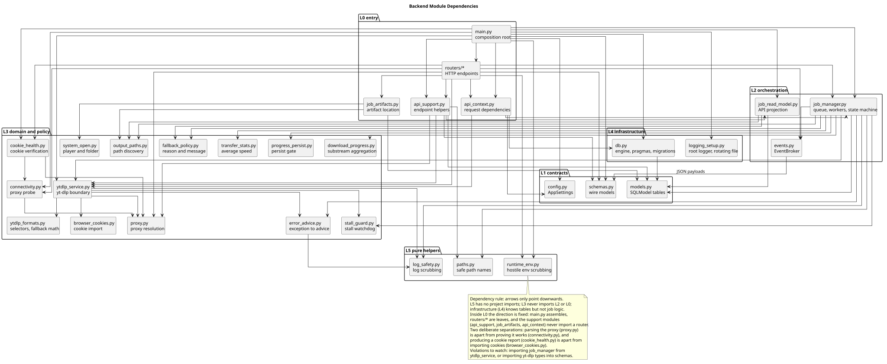
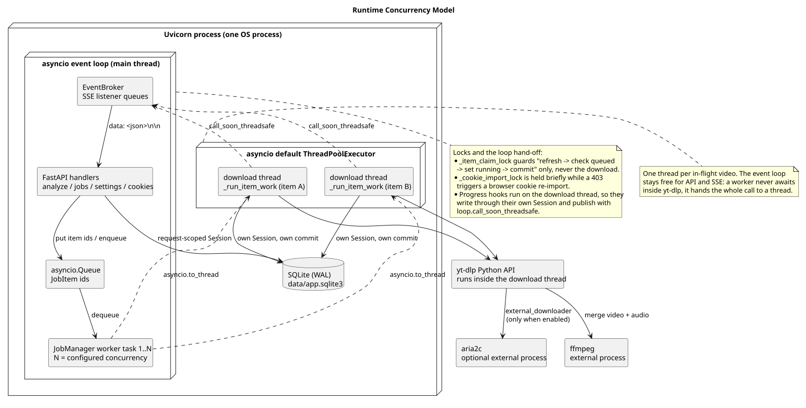
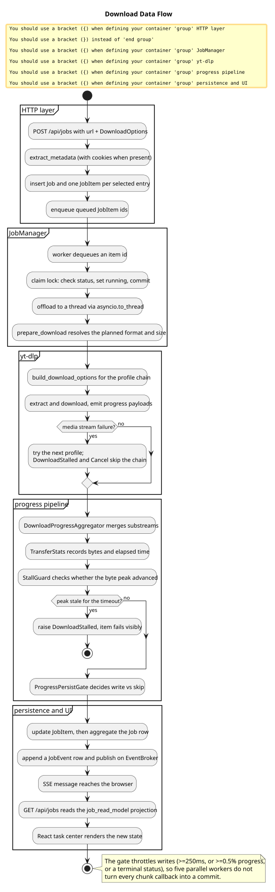

# 设计文档

适用读者：需要判断"这段逻辑该放哪一层""改动会不会破坏运行时假设"的开发者与维护者。

本页是 [架构设计](architecture.md) 的下一层：架构页回答"系统由什么组成、数据怎么流"，本页回答"模块怎么划分、依赖往哪个方向走、并发和持久化如何保证一致"。HTTP 字段级细节见 [API 文档](api.md)，参数与策略细节见 [技术文档](technical.md)。

## 设计目标与约束

| 目标 | 具体表现 | 代价 |
| --- | --- | --- |
| 本机单用户、零运维 | 单个 Python 进程 + 单文件 SQLite + 静态前端，无外部服务、无账号体系。 | 不做多用户隔离、不做水平扩展、不做跨机部署。 |
| 稳定优先 | 节流守卫默认关闭、停滞看门狗兜底、保留断点续传、同清晰度多 profile 重试。 | 单条流被限速时不再靠"换 fresh URL"自愈，只能慢速下完或等待看门狗判失败。 |
| 最小改动、可回退 | 每个行为开关都能用环境变量回退；数据库只做追加式补列。 | 没有正式迁移框架，无法安全删除/改名历史列。 |
| 失败必须可见 | 任何静默卡死最终都要变成任务中心里一条可读原因。 | 需要看门狗、错误分类和文案约束（文案不能含 `timed out` / `reset` / `403` 等会被误分类的词）。 |
| 不暴露 yt-dlp 全量能力 | API 只接受 `DownloadOptions`，不转发任意 yt-dlp 参数。 | 高级用法需要改代码，而不是改请求体。 |

## 目录结构（按功能分包）

`backend/app` 的**第一层目录按功能划分**，一个目录是一块能独立讲清楚的业务能力；层号（L0~L5）
写在矩阵里，**不写在目录名上** —— 两种切法同时存在时，目录回答「这段代码服务于谁」，
矩阵回答「它能依赖谁」。唯一被允许的跨层目录是 `contracts/` 与 `common/`：前者是各方共用的
接口定义，后者没有项目内依赖。

| 目录 | 内容 | 依赖方向 |
| --- | --- | --- |
| [main.py](../backend/app/main.py#L40) / [\_\_main\_\_.py](../backend/app/__main__.py#L64) | 装配根与进程入口。留在包根：`uvicorn app.main:app` 与 `python -m app` 都要求它们在这里，这是入口路径的一部分，不是可以挪动的实现细节。 | 向下装配一切 |
| [api/](../backend/app/api/__init__.py) | HTTP 契约：请求级依赖容器（`api_context`）、路由支撑（`api_support`）、按资源拆分的 [routers/](../backend/app/api/routers/__init__.py#L21)。 | 只被 `main` 使用，自己向下依赖 |
| [contracts/](../backend/app/contracts/__init__.py) | 契约：`config`（设置）、`models`（表结构）、`schemas`（线上模型）。 | 被任何层 import 都正常 |
| [download/](../backend/app/download/__init__.py) | YouTube 下载：队列与孤儿恢复、yt-dlp 边界、清晰度/字幕/降级决策、进度聚合、产物路径与删除判定。 | 依赖 `contracts` / `host` / `infra` / `common` |
| [bilibili/](../backend/app/bilibili/__init__.py) | B站 投稿：队列与编排、`biliup` 边界、会员接口与登录、元数据与文案、CC 字幕、HTTP 接缝。 | 依赖 `download`（复用产物路径与字幕计划）与 `contracts` / `infra` / `common` |
| [host/](../backend/app/host/__init__.py) | 本机宿主边界：代理解析、连通性探针、浏览器 cookies 与体检、进程环境、端口探测、系统打开。 | **不依赖任何项目内模块**（只依赖标准库与 `yt_dlp.cookies`），是各业务域共用的地板 |
| [infra/](../backend/app/infra/__init__.py) | 基础设施：数据库引擎、日志配置、进程内事件总线。 | 依赖 `contracts` |
| [common/](../backend/app/common/__init__.py) | 纯工具：`paths`、`log_safety`。 | 无项目内依赖 |

两条与「按功能分包」配套的硬约定：

1. **包内一律写相对导入**。`scripts/check_layers.py` 正是靠相对导入的 `level` 折算依赖目标的；
   写成 `from app.download...` 的绝对导入会绕过这条检查。层号变化时（模块上移一层），
   导入的 `..` 数目必须跟着变，否则运行期才炸。
2. **目录不是层的别名**。`bilibili/bili_http.py` 是 L4、`infra/` 里也有 L2 的 `events` ——
   决定放哪个目录看「它服务于哪块能力」，决定能否依赖看矩阵里的层号。

## 模块职责矩阵

每个模块只承担一类职责。"不负责"一列用于判断新代码应该落到哪里。

| 模块 | 层 | 职责 | 不负责 |
| --- | --- | --- | --- |
| [main.py](../backend/app/main.py#L40) | L0 入口 | **只做装配**：建 `ApiContext`、挂载 `api/routers/` 下的 `APIRouter`、静态资源托管、lifespan 启停。 | 不声明路由（路由在 `api/routers/`），不写业务规则，不做状态转换，不构造 yt-dlp 参数。 |
| [routers/](../backend/app/api/routers/__init__.py#L21) | L0 入口 | 按资源分模块声明 HTTP 路由（`diagnostics` / `cookies` / `analyze` / `jobs` / `job_files` / `settings` / `events` / `bilibili`）：取参、调辅助、定状态码。 | 不做状态转换，不直接调用 yt-dlp，不写领域规则（产物定位见 `job_artifacts`，设置与错误映射见 `api_support`）。 |
| [api_context.py](../backend/app/api/api_context.py#L28) | L0 入口 | 请求级依赖容器 `ApiContext`（`frozen` dataclass）+ `get_context` / `get_session` 依赖别名。 | 不装配依赖（装配在 `main.py`），不写业务规则。 |
| [api_support.py](../backend/app/api/api_support.py#L26) | L0 入口 | 路由支撑：任务/条目定位与 404、设置读写与响应构造、cookies 元数据提取、目录选择。 | 不声明路由，不做状态转换。 |
| [job_artifacts.py](../backend/app/download/job_artifacts.py#L31) | L0 入口 | 产物**定位**（一条候选链）与本机**打开**（播放 / 打开所在目录 / 打开字幕）。 | 不删文件（删除带白名单校验，属 `job_manager`），不决定用什么播放器或查看器（属 `system_open`）。 |
| [__main__.py](../backend/app/__main__.py#L64) | L0 入口 | 本地启动入口：解析命令行、启动前做端口预检并识别占用者、交给 uvicorn。 | 不装配应用（那是 `main.py`），不写业务规则。 |
| [config.py](../backend/app/contracts/config.py#L19) | L1 契约 | 声明全部设置字段、默认值与约束、目录准备。 | 不读数据库（`Setting` 覆盖在 `api_support.py` 里做）。 |
| [schemas.py](../backend/app/contracts/schemas.py#L14) | L1 契约 | 定义 HTTP 线上模型与枚举。 | 不引用 yt-dlp 类型，不含业务逻辑。 |
| [models.py](../backend/app/contracts/models.py#L27) | L1 契约 | 定义持久化表结构与 `JobStatus`。 | 不做读写编排。 |
| [job_manager.py](../backend/app/download/job_manager.py#L43) | L2 编排 | 队列、worker、并发、暂停/重启/删除、进度 hook、错误分类、终态收敛、事件发布、**启动时的孤儿条目恢复**。 | 不直接调用 yt-dlp（经 `YtDlpService`），不解析 yt-dlp 内部结构（经 formats 工具），**不做降级判定**（判定在 `resolution_decisions`），**不做孤儿条目的状态判定**（在 `orphan_recovery`）。 |
| [orphan_recovery.py](../backend/app/download/orphan_recovery.py#L48) | L2 编排 | 启动时把上次进程退出留下的 `queued`/`running` 条目收敛成重启后成立的状态（恢复 / 失败 / 取消 / 暂停），返回「要重新排队哪些」；按任务创建时间与条目序号排序。 | **不决定任务终态**（回到 `job_manager._maybe_finish_job`），不启动 worker、不入队、不发事件。 |
| [job_read_model.py](../backend/app/download/job_read_model.py#L12) | L2 编排 | 把表投影成 API 读模型：聚合分辨率/格式、`elapsed_seconds`、降级消息。 | 不写库、不改状态。 |
| [events.py](../backend/app/infra/events.py#L7) | L2 编排 | 进程内 SSE 扇出（每个订阅者一个队列）。 | 不持久化事件（持久化在 `job_manager`）。 |
| [bili_manager.py](../backend/app/bilibili/bili_manager.py#L328) | L2 编排 | B站 上传的队列与编排：单 worker 串行、投稿间隔（抗账号级频控）、状态写库与收敛、重启后把中断记录折成可重试失败、环境体检、事件发布。 | 不直接调 `biliup`（经 `bili_upload`），不解析 B站 内部结构（经 `bili_api`），不算界面徽标（经 `bili_read_model`）。 |
| [bili_read_model.py](../backend/app/bilibili/bili_read_model.py#L60) | L2 编排 | 把 `bili_upload` / `bili_season` 投影成 API 读模型；**「多条记录 → 一档徽标」的聚合规则**只在这里定义。 | 不写库、不改状态；`elapsed_seconds` 复用 `job_read_model`（见下方「同层横向依赖」）。 |
| [ytdlp_service.py](../backend/app/download/ytdlp_service.py#L88) | L3 领域 | yt-dlp 边界：元数据、预检测、参数构建、profile 重试链、错误分类、依赖诊断。 | 不碰数据库，不决定任务状态。 |
| [subtitle_plan.py](../backend/app/download/subtitle_plan.py#L200) | L3 领域 | 字幕下载**计划**：主语言判定（`-orig` 原声轨）、同族轨偏好、人工→ASR→跳过的收敛、来源标签与摘要文案。**纯逻辑**：不联网、不读库、不 import yt-dlp。 | 不写库、不发请求；不知道 `JobItem` 的存在（结论由 `job_manager` 取走）。 |
| [bili_subtitle.py](../backend/app/bilibili/bili_subtitle.py#L277) | L3 领域 | B站 CC 字幕：SRT/VTT → BCC 转换、语言标识映射、一次字幕上传（`posted` / `skipped` / `failed`）。 | **不参与稿件状态判定**、不写库、不重试；不知道端点长什么样（端点在 `bili_api`）。 |
| [ytdlp_formats.py](../backend/app/download/ytdlp_formats.py#L9) | L3 领域 | 格式选择器、分辨率/大小/codec 提取、降级候选计算。 | 不导入 yt-dlp。 |
| [stall_guard.py](../backend/app/download/stall_guard.py#L32) | L3 领域 | 纯函数式停滞判定与 `DownloadStalled`。 | 不写库、不发布事件。 |
| [fallback_policy.py](../backend/app/download/fallback_policy.py#L10) | L3 领域 | 降级原因常量与用户可读文案、重启建议。 | 不做降级决策（决策在 `resolution_decisions`）。 |
| [resolution_decisions.py](../backend/app/download/resolution_decisions.py#L71) | L3 领域 | 降级**决策**：值不值得找降级候选、降到哪、为什么、降不了时报哪句话。纯函数，可单测。 | 不发请求、不读库、不改 `JobItem`；可用清晰度由 `job_manager` 取好传进来。 |
| [download_progress.py](../backend/app/download/download_progress.py#L21) | L3 领域 | 多子流进度聚合与分母策略。 | 不知道数据库和 SSE 的存在。 |
| [progress_persist.py](../backend/app/download/progress_persist.py#L5) | L3 领域 | 决定某个进度快照是否值得落库。 | 不执行写库。 |
| [transfer_stats.py](../backend/app/download/transfer_stats.py#L5) | L3 领域 | 由字节增量累加平均速度。 | 不处理瞬时速度（瞬时速度直接取 payload）。 |
| [browser_cookies.py](../backend/app/host/browser_cookies.py#L55) | L3 领域 | 浏览器 cookies 提取、域名过滤、锁库与 CDP fallback。 | 不决定何时刷新（决策在 `job_manager`/`main`）。 |
| [cookie_health.py](../backend/app/host/cookie_health.py#L234) | L3 领域 | cookies **体检**：格式/域名/鉴权项/过期 + 一次 `LOGGED_IN` 探针合成结论。 | 不修改 cookies 文件，不决定解析用哪份（决策在 `main`）。 |
| [proxy.py](../backend/app/host/proxy.py#L169) | L3 领域 | 代理**解析**：显式 > 系统 > 环境，归一化与凭据脱敏。 | 不验证通不通（那是 `connectivity`），不发请求。 |
| [connectivity.py](../backend/app/host/connectivity.py#L73) | L3 领域 | 代理**验证**：一次朴素 HTTPS 探针，返回状态码/耗时/原始异常。 | 不解析代理来源，不复用 yt-dlp（避免混淆病因）。 |
| [error_advice.py](../backend/app/download/error_advice.py#L116) | L3 领域 | 异常链 → 可执行诊断（JS challenge / cookies / 代理 / 媒体流四类）。 | 纯字符串判定，不联网、不读库、不改变重试行为。 |
| [runtime_env.py](../backend/app/host/runtime_env.py#L58) | L5 纯工具 | 摘除会打坏 JS 运行时的宿主环境变量，并返回可留痕的记录。 | 只动本进程 `os.environ`，不改系统设置。 |
| [dev_server.py](../backend/app/host/dev_server.py#L44) | L5 纯工具 | 端口可用性探测、向后找可用端口、`netstat` / `tasklist` 输出的解析。 | 不启动服务、不改配置；拿不到占用者信息时返回 `None` 而不是猜一个名字。 |
| [output_paths.py](../backend/app/download/output_paths.py#L13) | L3 领域 | 输出文件、中间文件与 sidecar 的候选路径解析与发现。 | 不删除文件（删除由 `job_manager` 在受限根目录内执行）。 |
| [safe_delete.py](../backend/app/download/safe_delete.py#L22) | L3 领域 | 删除产物的**路径安全判定**：允许范围（`DeleteScope`）、某路径是否可删、任务目录是否可收走。纯函数，可单测。 | 不删任何东西（`unlink` / `rmdir` 由 `job_manager` 执行），不枚举候选（枚举在 `output_paths`）。 |
| [bili_upload.py](../backend/app/bilibili/bili_upload.py#L299) | L3 领域 | **单次上传的领域逻辑**：编排 `bili_bin` + `bili_api` + `bili_meta`，产出「已发布/审核中/待核对/失败」的结论与下一步。含模板批量渲染与逐条校验。纯函数式，可整链离线单测。 | 不写库、不发事件、不做队列；不重试、不改状态。 |
| [bili_bin.py](../backend/app/bilibili/bili_bin.py#L271) | L3 领域 | 投稿工具边界：`biliup` 探测（含 WinGet 0 字节空壳识别与修复）、命令组装、子进程执行、进度解析、ffmpeg 抽封面。 | 不写库、不发 B站 请求、不生成元数据。 |
| [bili_api.py](../backend/app/bilibili/bili_api.py#L124) | L3 领域 | B站 会员态客户端：稿件对账、稿件详情（cid/封面）、创建合集、归集稿件、列出合集、发并置顶评论。全部经可注入 `transport`。 | 不调 `biliup`、不读库、不决定「该不该归集」。 |
| [bili_auth.py](../backend/app/bilibili/bili_auth.py#L75) | L3 领域 | 扫码登录（生成二维码 / 轮询状态）、**TV 端三步换投稿令牌**、登录文件读写（四形态兼容）、**凭据摘要（只回传名字与计数，无值、无前缀）**、是否被 git 跟踪。 | 不发 B站 业务请求、不写库。 |
| [bili_meta.py](../backend/app/bilibili/bili_meta.py#L202) | L3 领域 | 投稿元数据：模板占位符渲染（显式替换，不用 `str.format`）、标签派生与收敛、分区小词表、平台硬限校验。 | 超限只报错不截断；不计长度之外的事，不读库、不发请求。 |
| [bili_policy.py](../backend/app/bilibili/bili_policy.py#L38) | L3 领域 | B站 上传的**文案与分类常量**：平台状态码→人话、记录状态→人话、错误输出→（结论 + 下一步）、徽标档位与配色。 | 不做判定（判定在 `bili_upload` / `bili_manager` / `bili_read_model`）。 |
| [system_open.py](../backend/app/host/system_open.py#L28) | L3 领域 | 选择可解码播放器、打开目录、**把文件交给系统打开（默认关联）或弹自带的「打开方式」对话框**、窗口置前。 | 不校验文件是否存在（调用方先解析路径）；**不维护编辑器清单**（对话框的候选读系统注册表），也不存「程序偏好」。 |
| [db.py](../backend/app/infra/db.py#L27) | L4 基础设施 | engine 创建、SQLite pragma、补列、WAL checkpoint、session 依赖。 | 不知道业务表语义。 |
| [logging_setup.py](../backend/app/infra/logging_setup.py#L48) | L4 基础设施 | 配置 root/uvicorn logger，落盘 `data/logs/app.log` 并轮转。 | 不决定打什么日志，不解析业务语义。 |
| [bili_http.py](../backend/app/bilibili/bili_http.py#L66) | L4 基础设施 | B站 请求的 HTTP 接缝：标准库 `urllib` 实现、**强制直连（清空 ProxyHandler）**、4xx/5xx 也带回正文与 `Set-Cookie`。 | 不知道任何端点的语义（端点与参数在 `bili_api` / `bili_auth`）。 |
| [paths.py](../backend/app/common/paths.py#L7) / [log_safety.py](../backend/app/common/log_safety.py#L20) | L5 纯工具 | 文件名安全化、日志敏感信息清洗。 | 无项目内依赖，可单独测试。 |

## 前端组件边界

`App.tsx` 只负责状态编排（解析、建任务、设置回灌、SSE 订阅）与整体布局。其余按**功能**分目录 ——
与后端的切法一致：目录回答「服务于谁」，不回答「是什么类型」。组件、判定与文案放在同一个功能目录里，
因为它们改起来的原因通常是同一个（B站 上传改一次，`BiliUploadDialog` 与 `biliForm` 往往要一起改）。

| 目录 | 内容 | 依赖方向 |
| --- | --- | --- |
| [App.tsx](../frontend/src/App.tsx) / [main.tsx](../frontend/src/main.tsx) | 编排根与入口，留在 `src/` 根：`index.html` 与 `main.tsx` 按 `./App` 取它 | 向下装配一切 |
| [contracts/](../frontend/src/contracts/types.ts) | 线上契约 `types.ts`，与后端 `contracts/schemas.py` 一一对应，由 `check_api_contract.py` 逐接口对照 | 被任何目录 import 都正常 |
| [shared/](../frontend/src/shared/) | 跨功能复用：`api`（HTTP 边界 + 超时看门狗）、`errors` / `formatting` / `quality` / `subtitles`；[ui/](../frontend/src/shared/ui/) 放**无业务判断**的基础件（`HelpPopover` / `Toggle` / `StatusPill`） | 不依赖任何功能目录 |
| [download-request/](../frontend/src/download-request/) | 发起下载：解析链接（`UrlAnalyzer`）、解析结果（`AnalysisPanel`）、下载选项（`DownloadOptionsPanel` / `SearchableLanguageSelect`） | 依赖 `shared` / `cookies` |
| [cookies/](../frontend/src/cookies/) | 浏览器 cookies 的导入、校验与锁库映射（`CookieSection` / `cookieLock`） | 依赖 `shared` |
| [task-center/](../frontend/src/task-center/) | 任务中心：控制 / 删除 / 展开、进度与明细、本地文件操作、清晰度降级的重启（`JobQueue` / `SubtitleOpenButton`） | 依赖 `shared` / `bilibili` |
| [settings/](../frontend/src/settings/) | 设置、代理检测与运行环境自检（`SettingsPanel` / `ProxySection`） | 依赖 `shared` / `bilibili`（登录区） |
| [bilibili/](../frontend/src/bilibili/) | B站 上传：入口、表单、进度、状态明细、登录区，以及 `biliForm` / `biliStatus` / `biliProgress` / `biliHealth` 四块判定与文案 | 依赖 `shared` / `contracts` |
| [notifications/](../frontend/src/notifications/) | 任务完成提醒：终态判定与浮层队列（`notifications`）、右下角浮层（`CompletionToasts`） | 依赖 `contracts` |
| [test/](../frontend/src/test/) | 共享夹具 `appFixtures` / `appHarness` / `cssRules` / `setup`，不含业务判断 | 只被测试 import |

两条与「按功能分目录」配套的约定：

1. **测试跟着它测的能力走，不跟它 `render` 谁走**。多数 `*.test.tsx` 都 `render(<App/>)`（这是有意的集成口径：
   路由与编排之间的接线最容易错），但归属看**断言描述的是谁的行为** —— 例如
   [task-center/resolution-fallback.test.tsx](../frontend/src/task-center/resolution-fallback.test.tsx) 断言的是任务卡上的
   「以 720p 重启」，所以它属于任务中心，不属于下载选项。
2. **只有「一份」的东西才进 `shared/`**：一个模块被两个以上功能目录 import，才说明它不属于某个功能。
   只被一个功能用的判定（如 `biliStatus`）留在该功能目录里，别提前「抽象」出去。

判断新代码放哪：**需要 `useState` 或发请求吗？** 需要就留在 `App.tsx`（或抽成 hook）；
只把 props 变成界面就进对应功能目录；是一段跨功能复用的纯计算就进 `shared/`。

| 组件 / 模块 | 职责 | 不负责 |
| --- | --- | --- |
| [UrlAnalyzer.tsx](../frontend/src/download-request/UrlAnalyzer.tsx#L29) | 解析面板：链接输入、cookies 行（状态 + 上传/清除 + 浏览器导入）、锁库提示、解析按钮。只持有「选了哪个浏览器」这类纯界面状态。 | 不发请求（回调交 `App`），不决定用哪份 cookies。 |
| [AnalysisPanel.tsx](../frontend/src/download-request/AnalysisPanel.tsx#L12) | 解析结果：缩略图/标题/时长、playlist 条目勾选表、单视频汇总行。 | 不持有选中集合（状态归 `App`，提交要用同一份）。 |
| [DownloadOptionsPanel.tsx](../frontend/src/download-request/DownloadOptionsPanel.tsx#L19) | 下载选项：模式、清晰度、字幕语言/来源/格式、开关项、限速与重试、提交按钮。 | 不持有状态：所有值来自 `options`，改动经 `onOptionChange` 回到 `App`。 |
| [SearchableLanguageSelect.tsx](../frontend/src/download-request/SearchableLanguageSelect.tsx#L16) | 可搜索的字幕语言多选。标签里 join 的是**语言代码**，项数无上界 —— 不许 `nowrap`，见 [ai/ui/003](../ai/ui/003-language-trigger-label-overflows-the-page.md)。 | 不拉取可用语言（由 `App` 从解析结果里汇总）。 |
| [SettingsPanel.tsx](../frontend/src/settings/SettingsPanel.tsx#L69) | 设置：下载目录、并发、单视频并发下载数（aria2c）、代理（含连通性检测）。持有一份 `draft`，**失焦即保存**；单视频并发下载数旁挂一个说明浮层（`Aria2cHelpPopover`）。 | 不解析代理来源（后端回传 `proxy_source`），不决定代理语义（留空=自动、`direct`=直连由后端定义）；也不判断「aria2c 此刻是否真的在用」——那由后端的 profile 链决定，界面只解释怎么启用。 |
| [Toggle.tsx](../frontend/src/shared/ui/Toggle.tsx#L4) / [StatusPill.tsx](../frontend/src/shared/ui/StatusPill.tsx#L4) | 基础件：勾选行、顶栏状态点。 | 不含业务判断（`ok === undefined` 一律按警告渲染）。 |
| [CookieSection.tsx](../frontend/src/cookies/CookieSection.tsx#L121) | cookies 状态、校验按钮与结论展示；两个说明浮层（[获取方式](../frontend/src/cookies/CookieSection.tsx#L53)、[结论解读](../frontend/src/cookies/CookieSection.tsx#L96)）就近挂在这里。 | 不决定用哪份 cookies（后端决定），不构造请求体。 |
| [ProxySection.tsx](../frontend/src/settings/ProxySection.tsx#L140) | 代理检测结果展示与「真的发一次请求」的入口；[常用端口](../frontend/src/settings/ProxySection.tsx#L75)与[排查顺序](../frontend/src/settings/ProxySection.tsx#L112)两个说明浮层。 | 不解析代理来源（后端回传 `proxy_source`），不保存设置（保存由 `SettingsPanel` 触发）。 |
| [HelpPopover.tsx](../frontend/src/shared/ui/HelpPopover.tsx#L42) | **通用非模态说明浮层**：定位、钉住、关闭、记忆，以及窄屏抽屉形态。所有辅助说明共用它。 | 不含任何业务文案（文案由调用方以 children 传入）。 |
| [JobQueue.tsx](../frontend/src/task-center/JobQueue.tsx#L23) | 任务中心展示与本地文件操作入口（播放 / 打开文件夹 / 打开字幕 / 删除）。 | 不直接访问本机文件系统（一律走后端受控打开/删除接口）。 |
| [SubtitleOpenButton.tsx](../frontend/src/task-center/SubtitleOpenButton.tsx#L19) | 「打开字幕」的**一颗**按钮：点它弹系统的「打开方式」，由用户当场挑程序。 | 不维护编辑器清单、不记住「上次用的程序」（那是系统的职责，见 [technical.md](technical.md#打开字幕文件)），不发请求（`onOpen` 归 `App`）。 |
| [BiliIcon.tsx](../frontend/src/bilibili/BiliIcon.tsx#L12) | B站 图标：圆角机身 + 两根天线 + 两只眼睛的**手绘** SVG，描边走 `currentColor` 由调用方决定颜色。 | 不含任何布局与文案；品牌色只落在这个图标上，不扩散成按钮配色。 |
| [BiliUploadButton.tsx](../frontend/src/bilibili/BiliUploadButton.tsx#L42) | 任务行/条目行上的上传入口：**图标 + 一句人话**。`idle` 档显示动作词（「上传到 B站」），其余档原样显示后端徽标文案 —— 前端不自己造一套状态文案，两处必然会漂移。**改的是「点下去做什么」，不是「长什么样」**：`uploaded` → 打开稿件页；`unverified` / `partial` → 只补没成功的那几条；`uploading` → 灰着不动；只有 `failed` 打开上传表单。 | 不请求、不判断能不能传（`disabledReason` 由 `App` 给），不决定上传什么，也不判「哪条该重投、哪条只该核对」（那是服务端按每条终态决定的）；「打开哪一个页面」由 [`uploadedTargetUrl`](../frontend/src/bilibili/biliStatus.ts#L129) 算，要补哪几条由 [`retryableUploadIds`](../frontend/src/bilibili/biliStatus.ts#L147) 算。 |
| [BiliUploadProgress.tsx](../frontend/src/bilibili/BiliUploadProgress.tsx#L15) | 任务卡片里的**上传进度**：四段轨迹（排队/传输/提交/核对）+ 当前段动效 + 每秒推进的「已用/已提交」。只在需要等的时候渲染（在跑或审核中）。 | 不判「算不算成功」（那是后端徽标）、不画百分比（`biliup` 没有字节进度，见下）；不请求。 |
| [BiliUploadDialog.tsx](../frontend/src/bilibili/BiliUploadDialog.tsx#L65) | 上传表单模态框，**单视频与合集共用**：单视频填的就是最终内容，合集填的是模板（`{index}` `{title}` `{count}` `{job}` 占位符）并带一张逐条预览表。硬限数字来自 `prefill.limits`，超限只报错不截断，未就绪的条目先标出来。**标题框旁边就能看出超没超**：超限时追加「超出 N 个字」并加 `is-over` / `aria-invalid`；合集另给一行「渲染后最长 N/上限（第 X 条…）」。`prefill.reused` 时明说「已填入上一次投稿的内容」，合集名也优先用上次填的那个。预览表还有一列**字幕**，显示服务端算好的 `item.subtitle`。 | 不渲染模板（渲染在后端 `bili_meta`，前端只显示服务端给的结果），不校验硬限（判据在 `biliForm.localPreflight`，这里只显示结论），不拼字幕文案（那句由后端 `subtitle_summary` 给），不发请求（`onSubmit` 归 `App`）；**不自己决定复用什么**（复用来源在服务端 `build_prefill`）。 |
| [BiliJobStatus.tsx](../frontend/src/bilibili/BiliJobStatus.tsx#L19) | 任务卡片里的上传明细与「下一步」：失败原因 + 服务端给的 advice、合集归集结论、重试入口。**只在有话说时渲染一行**。 | 不决定重试动作（后端按终态三选一），不给已成功的条目放重试按钮。 |
| [BiliLoginSection.tsx](../frontend/src/bilibili/BiliLoginSection.tsx#L32) | 设置面板里的 B站 区：环境体检（**点「重新体检」会变「体检中…」并禁用，结束后写「上次体检 HH:MM:SS」**）、扫码登录（含轮询，1.5s）、导入登录文件、修复投稿工具。**凭据一个字符都不显示**（只给「已保存 N 项 / 缺 SESSDATA」的摘要与账号名）。 | 不显示 cookies 值或掩码前缀；「登录文件被 git 跟踪」单独红字，不由本组件自动修复；**超时/降级策略不在这里**（在 `biliHealth`），也不发请求（走 `api.ts`）。 |
| [subtitles.ts](../frontend/src/shared/subtitles.ts#L12) | 字幕文案与来源归一：`formatSubtitleInfo`（那行「字幕：来源 X · 格式 Y」）、`effectiveSubtitleSourceForAnalysis`（提交前把「两者都要」收敛成该视频真有的那一类）。 | 不做请求、不读存储。 |
| [cookieLock.ts](../frontend/src/cookies/cookieLock.ts#L20) | 把后端 `browser_locked` 错误映射成界面状态（含 `pendingAnalyzeUrl`，用于「关闭 Edge 并导入」后自动补一次解析）。判据是 `detail.code`，不是文案。 | 不渲染界面（渲染在 `UrlAnalyzer`）。 |
| [biliForm.ts](../frontend/src/bilibili/biliForm.ts#L129) | 投稿表单的**词汇表与预检**：版权/归集方式的取值、标签计数与最长标签、三种说明与回执文案、提交前的本地预检、**字符预算**（`charBudget`：`length/limit/over/label/warning` 一起算出来，单看数字看不出超没超）与**合集渲染后的标题长度**（`collectionTitleBudget`：量的是渲染后的每一条，不是模板本身）。硬限数字一律取自 `prefill.limits`，**不写死**（含「报超长标签时回显多少个字」，那是 `limits.tag_preview`）。 | 不改 `input`（报错而不是修好再提交，与服务端 `bili_meta.validate` 同一条约定）；不渲染、不发请求；**不是权威校验**（服务端 `bili_meta.validate` / `bili_upload.validate_collection` 才是，这里报的它一定报、它报的这里尽量也报）。 |
| [biliStatus.ts](../frontend/src/bilibili/biliStatus.ts#L24) | 稿件/合集状态的**判定**：能不能重试、算不算出问题、哪一档徽标是「还没上传」，以及两件「点这一下该去哪儿」的事：`uploaded` 打开哪个页面（`uploadedTargetUrl`）、`unverified`/`partial` 该补哪几条记录（`retryableUploadIds`）。判据一律是「用户此刻该做什么」，取值本身在 [types.ts](../frontend/src/contracts/types.ts#L266)。 | 不造文案（徽标文案来自服务端 `badge_text`）；不决定重试动作（后端按终态三选一）；不拼 URL（`video_url` 由后端给）。 |
| [biliProgress.ts](../frontend/src/bilibili/biliProgress.ts#L23) | 上传进度的**判定**：一条记录处在哪一段、在等什么（`uploadStageView`）、一个任务该显示哪一条与多少条已确认（`jobUploadProgress`）、「已用 01:23」（`uploadElapsedLabel`）。四段是四个**步骤**，不代表四段时间。 | 不造文案之外的状态、不请求、不决定是否显示（由 `waiting` 决定）。 |
| [biliHealth.ts](../frontend/src/bilibili/biliHealth.ts#L48) | 「重新体检」的**策略**与「等一次会打 B站 的请求」的预算（`BILI_CALL_TIMEOUT_MS = 25 s`，体检与合集列表共用，**必须大于后端那 20 秒**）：超时退回**离线**体检并标 `timedOut`；探测**失败**也退回离线体检，原因放 `probeError`（原先直接抛 ⇒ 只剩页顶一条红条、面板还是旧结论）；只有「连离线都读不到」才抛。 | 不渲染界面、不拼文案（文案在 `BiliLoginSection`）、不决定探什么（两个 loader 由调用方注入）。 |
| [errors.ts](../frontend/src/shared/errors.ts#L15) | 异常 → 一句可显示的话（`errorMessage`）。收口原先散在十几处的 `err instanceof Error ? err.message : fallback`——重写一遍的代价不是行数，而是**语义各自漂移**（有的在 `message` 为空时兜到 fallback，有的不兜）。 | 不看 `ApiError.detail`：把 `advice` 拼进文案只在 `App.biliMessage`，只有那条链路会带 `advice`。 |
| [notifications.ts](../frontend/src/notifications/notifications.ts) | 「任务跑完了」的提醒**判定**：哪些状态算终态（`succeeded`/`failed`，`cancelled` 不算——取消是用户自己点的）、一条提醒写成什么话（`describeCompletion`）、浮层队列的生命周期（`useCompletionToasts`：自动缩回、悬停暂停、**后台标签页不倒计时**）。提示音参数与下拉选项也是常量。 | 不发声、不渲染（声音在 `CompletionToasts` 里用 Web Audio 现场合成）；不决定「要不要提醒」（那是逐任务的 `notify_on_complete`）与「用什么方式」（那是全局 `completion_notification`）。 |
| [CompletionToasts.tsx](../frontend/src/notifications/CompletionToasts.tsx#L21) | 右下角**浮层容器**：渲染 `notifications.ts` 给出的队列，悬停暂停缩回、可手动关。同时是提示音的出口（Web Audio 现场合成 C6→G6，没有任何音频文件跟着仓库走）。 | 不判断谁该被提醒（判定在 `notifications.ts`）；不读设置（方式由 `App` 传入）。 |

说明浮层的设计约束（这几条是界面改版时最容易破坏的，改之前先读）：

1. **默认收起，且同一时刻最多展开一块**：说明是次要信息，不允许常驻版面。钉住状态写 `localStorage`（键前缀 `cascade.help.open.v1.`），关闭时一并清除记忆 —— 所以刷新后最多只有一块保持展开，见 [rememberOpen](../frontend/src/shared/ui/HelpPopover.tsx#L29)。
2. **不抢焦点、不阻塞操作**：面板 `aria-modal=false`、打开时不 `autoFocus`、没有遮罩层，触发按钮在 `mousedown` 时阻止默认行为。这样在点开「常用端口」时，代理输入框里的光标和未保存的输入都不会被打断。
3. **窄屏改形态而不是改内容**：`≤640px` 或设备无 hover 能力时渲染为贴底抽屉（`is-sheet`），左右各留 8px、高度上限 62vh，见 [SHEET_QUERY](../frontend/src/shared/ui/HelpPopover.tsx#L18)。
4. **浮层内部不允许横向溢出**：面板宽度上限 440px，三列表格会在浮层内撑出滚动条并把列截掉 —— 代理端口对照因此用两列网格而不是表格。浮层挂在 `white-space: nowrap` 的宿主元素（例如状态文字）内时，必须显式重置 `white-space` 与字重，否则说明文字会继承成一行粗体。
5. **固定宽度的轨道里，文本必须能断行**：`.grid` 的右栏是写死的 `390px`（[styles.css](../frontend/src/styles.css#L104)），内容区只剩 352px，而 grid item 的 `min-width: auto` 不允许它被压窄 —— 因此「放不进一行的长 token」（自检回显的 Windows 路径、URL、后端错误原文）会让面板的 min-content 超过轨道，把整页撑出横向滚动条。右栏因此整体声明 `overflow-wrap: anywhere`（[styles.css](../frontend/src/styles.css#L124)，靠继承覆盖全部后代），见 [ai/ui/002](../ai/ui/002-side-column-overflow-breaks-the-page.md)。**必须用 `anywhere`**：`overflow-wrap: break-word` 不改变 min-content，挡不住这一类溢出。
6. **会随数据变长的标签必须允许换行，不得用 `nowrap` 把它锁成一行**：字幕语言选择器的标签是 `已选 N 项：en, zh-Hans, …`（join 的是**语言代码**，N 无上界）。它曾经是 `white-space: nowrap` + `overflow: hidden; text-overflow: ellipsis`，意图是「太长就省略号」—— 但 nowrap 之下没有断行机会，`overflow-wrap` 对它**无效**，标签的 min-content 就等于整段文字，而它是 flex item、父级按它的 min-content 算宽度 → 放不下时不是被裁，是把右栏轨道和整个网格一路顶宽（12 种语言实测 84px），见 [ai/ui/003](../ai/ui/003-language-trigger-label-overflows-the-page.md)。判据：**`ellipsis` 只在元素真的被约束时才会出现** —— 先看 `scrollWidth > clientWidth` 成不成立；不成立就说明「省下来的空间」并没有省下来，只是换了个样子出问题。

## 依赖方向与分层规则

PlantUML 源文件：[module-dependencies.puml](diagrams/module-dependencies.puml)。这张图的**边集**由 `python scripts/check_diagram_edges.py` 与 `backend/app` 的实际 import 逐条对照（缺边、多边、图上有没画的模块都算错）—— 它与 `docs.py check` 分工不同：后者只保证 SVG 与 `.puml` 同源，两份一起过期时照样通过。

规则：

1. 依赖只向下：L0 → L1/L2/L3/L4，L2 → L1/L3/L4，L3 → L3/L5，L4 → L1，L5 不依赖任何项目模块。
2. **L3 不得反向依赖 L2 或 L0**。典型反例：让 `ytdlp_service` 去更新 `JobItem` 状态。正确做法是把结果返回给 `job_manager`，由编排层决定状态。
3. **L1 保持纯净**：`schemas.py` 不导入 yt-dlp，`config.py` 不导入数据库层。这样 API 契约可以脱离运行时被单独审阅、测试和生成文档。
4. 新能力优先落到 L3 的单一模块（例如"判断是否需要合并音视频"属于 `ytdlp_formats.requires_ffmpeg`），只有需要"在多个模块之间做决定"时才上移到 L2。
5. 同一层内部的横向依赖要显式说明理由。当前存在的横向依赖：`job_manager` → `ytdlp_formats`（复用降级计算）、`job_read_model` → `output_paths`（复用路径发现）、`bili_read_model` → `job_read_model`（复用 `elapsed_seconds`）、`bili_upload` → `bili_bin` / `bili_api` / `bili_auth` / `bili_meta` / `bili_policy`（单次上传的编排，全部是复用而非成环），都是复用纯函数，不构成循环。L0 内部另有一组单向横向依赖：`api/routers/*` → `api_support` / `job_artifacts` / `api_context`，方向固定（路由是叶子，支撑模块不反向导入任何路由），因此不会成环。跨功能包只有一条：`bilibili` → `download`（复用产物路径 `output_paths`、字幕计划 `subtitle_plan`、`ytdlp_service` 与 `job_read_model.elapsed_seconds`），方向朝同层或下层，不构成循环。
6. **组合根只做装配**：`create_app` 里出现业务分支即为越界 —— 判断「这段代码该放哪」的判据是"它需不需要一个 `Request`"，需要就进 `api/routers/`，只是一段被多个路由复用的逻辑就进 `api/api_support.py` / `download/job_artifacts.py`。

## 运行时并发模型

PlantUML 源文件：[runtime-concurrency.puml](diagrams/runtime-concurrency.puml)。

单进程内部有两种执行载体：

- **事件循环（主线程）**：FastAPI 请求处理、`EventBroker` 扇出、`JobManager` 的 worker 任务与队列。所有状态机的状态转换发生在这一侧（其中一部分经锁保护后落到工作线程）。
- **工作线程**：每个在途视频占用一个线程。worker 任务用 `asyncio.to_thread(self._run_item_work, item_id)` 把整段下载搬出事件循环，因此 yt-dlp 的同步阻塞不会卡住 API 和 SSE。

由此推出三条必须遵守的约定：

1. **进度 hook 在工作线程上执行**，所以它使用自己的 `Session` 写库，不能复用请求级 session。
2. **从线程发布事件要跨回事件循环**：[_publish_threadsafe](../backend/app/download/job_manager.py#L1228) 先写 `JobEvent` 行，再 `loop.call_soon_threadsafe` 调度 `broker.publish`。异步路径直接用 [_publish](../backend/app/download/job_manager.py#L1215)。
3. **锁只保护状态转换，不保护下载**：`_item_claim_lock` 只覆盖"刷新 → 校验 queued → 置 running → commit"；`_cookie_import_lock` 只在 403 后的 cookies 刷新导入期间持有。下载本身靠 `should_cancel` 回调协作取消，而不是靠锁。
4. **单个条目的收尾出错不能带走 worker**：worker 循环对每条 item 的整段工作加了兜底 —— 崩溃的条目被标记为 `failed`（而不是永远停在 `running`），worker 继续消费队列。没有这层兜底，一个条目的记账错误就会静默地少掉一个并发口。见 [008](../ai/bug-fix/008-return-in-finally-swallows-the-real-error.md)。
5. **队列不跨进程存活，所以启动时必须先对账**：`asyncio.Queue` 随进程消失，而库里还留着 `queued`/`running`。启动序列是「先改库、再 `start()`」——反过来 worker 会与被扫描的行并发读写。见 [015](../ai/bug-fix/015-orphan-items-never-resume.md)。

并发度语义：并发是**视频级**的——worker 数等于当前并发设置，队列里流动的是 `JobItem` id。单视频任务只有 1 个 `JobItem`，因此并发设置对它无效；`set_concurrency()` 通过新增 worker 任务或投放 `None` 哨兵来调整规模。

## 关键数据流

PlantUML 源文件：[download-data-flow.puml](diagrams/download-data-flow.puml)。

### 解析链接

`POST /api/analyze` → `YtDlpService.extract_metadata()`（`extract_flat="in_playlist"`，带 cookies）→ `AnalyzeResponse`。若 yt-dlp 抛出的错误同时命中 cookies 提示词，则自动导入浏览器 cookies 后**重试一次**，见 [extract_metadata_with_cookies](../backend/app/api/api_support.py#L95)。

### 建任务与入队

`POST /api/jobs` → 解析 → 选条目（单视频合成 1 条 `VideoEntry`）→ 写 `Job` + N 个 `JobItem` → `enqueue()` 把 queued item id 放进队列。playlist 任务会额外在下载根目录下按安全化标题创建子目录，见 [job_download_dir](../backend/app/api/api_support.py#L87)。

### 下载与进度

worker 领取 item → 声明式预检测（`prepare_download`，命中则不再二次 `extract_metadata`）→ 下载 → 进度 hook 依次经过 `StallGuard` 与 `DownloadProgressAggregator`，再由 `ProgressPersistGate` 决定是否落库 → `JobEvent` 持久化 + SSE 通知 → 前端收到信号后重新拉取 `/api/jobs` 读模型。终态写入平均速度并收敛任务状态。

### 字幕下载计划

字幕在**预检的同一次元数据里**就定了，不为它多发一次请求：

`prepare_download` 取 `info` → `_subtitle_plan(info, options)` 产出 `SubtitlePlan`（语言族 / 真实轨码 /
来源 / 理由），挂在 `DownloadPreparation.subtitle` 上回传给 `job_manager` →
`_options_with_subtitle_plan` 把 `subtitle_languages` 收敛成**一条**（仅当用户没显式指定语言时）→
yt-dlp 自己按「人工先占、自动只补缺」的顺序挑 → 下载成功后 `_record_subtitle_result` 按**磁盘证据**落库。

三条必须记住的约束（详见 [ai/feature/subtitle-pipeline/02](../ai/feature/subtitle-pipeline/02-design.md)）：

1. **主语言是平台给的，不是猜的**：yt-dlp 给原始语音那条 ASR 轨加 `-orig` 后缀，
   `zh-Hans-orig` 存在 == 这个视频说的是中文。粤语 `yue` 不算中文。
2. **「跳过字幕」不能用空语言列表表达**：空 `subtitleslangs` 被 yt-dlp 当「没给」，它会按自己的默认
   去挑英文 —— 把「跳过」悄悄变成「下载英文」。必须请求一个**匹配不到任何轨**的值（族名 `zh` / `en`
   正好如此），靠 `fullmatch` 落空实现「一条都不下、也不报错」。更不许退化成 `["all"]`
   （一次拉 20+ 条轨会撞 429，连视频本体一起失败），所以 `SubtitlePlan.languages` 被设计成**永远 0 或 1 条**。
3. **落库信磁盘不信计划**：yt-dlp 对「请求的语言不存在」是静默跳过（不报错），
   所以「计划说有」与「真的写出来了」是两件事。`NULL`（这一轮没有结论）与 `none`（结论是没有）
   也必须分开，否则用户刚提交任务就会看到「无字幕」。

### 设置变更

`PUT /api/settings` → 写 `Setting` 行 → 按字段分派副作用：并发调整 worker 数；限速/重试改写 queued/running/paused 任务的 `options_json`，并把正在运行的 `JobItem` 标记为待重启（`_runtime_restart_items`），让当前 yt-dlp 实例抛出 `DownloadCancelled` 后重新入队，靠 `.part` 续传应用新参数；`aria2c_connections`（界面：单视频并发下载数）只更新设置与 `YtDlpService`，不影响正在进行的任务。

### 删除与文件清理

删除统一走 `JobManager`：先删数据库记录与关联 `JobEvent`，再按需删除文件。文件删除只在"下载根目录"或"该任务下载目录"之内执行，并对 `output_path`、合并后的最终文件与 sidecar 分别枚举候选，见 [_delete_output_files](../backend/app/download/job_manager.py#L399)。删除 playlist 的最后一个子项时父任务一并删除。

### 播放与打开本地文件

`POST /api/jobs/{id}/play`、`.../open-folder`、`.../open-subtitle`（以及条目级的同名三条）都不收路径：后端按
`job_artifacts` 的候选链定位，再交给 `system_open`。**「用哪个程序」这条判断只在 `system_open` 里出现一次**：

- 播视频要挑一个**能解码当前格式**的播放器（`mkv`/`vp9`/`opus` 这类默认关联可能打不开），
  所以它有一份候选清单与一条降级规则；
- 打开目录要新开一个 Explorer 窗口并尽量置前（只在任务栏闪烁等于没打开）；
- 打开字幕**不挑程序**：应用侧不维护「程序偏好」，对话框里的候选来自**系统注册表为该后缀登记的处理器**。
  界面上那颗按钮走 `mode=chooser`（接口缺省），弹应用自带的「打开方式」对话框（系统那套 UI 在本机
  整体降级成一个提示框，不可依赖，见 [bug-fix/023](../ai/bug-fix/023-the-open-with-dialog-that-never-opened.md)）；
  `mode=default` 走文件关联，只留给接口调用方。若 Windows 还没有该后缀的关联，`default` 模式**自动改弹
  这个对话框**而不是报错（资源管理器也是这个行为）。

三条路都把失败翻译成「用户能据以行动」的状态码：文件/产物没有 → 409，任务或条目不存在 → 404，
系统打开器本身失败 → 400，前端在对应那一行就地显示。

### 上传到 B站

上传是一条**独立于下载的**链路，两者只通过「下载好的文件」相接：下载链路不认识 B站，上传链路不触发下载。它由 `BiliManager` 的**单 worker** 串行驱动（不是 `JobManager` 的那组并发 worker），因为平台限的是账号而不是本地并发。

单视频：`GET /api/bilibili/prefill` 预填表单 → `POST /api/bilibili/uploads` 落一行 `queued` 的 `BiliUpload` 并入队 → worker 依次做「抽帧封面（可选）→ `biliup` 投稿 → 回读稿件列表对账 → 发并置顶评论（可选）」→ 状态收敛为 `published` / `reviewing` / `unverified` / `rejected` / `failed` → SSE 通知，前端按 `GET /api/bilibili/uploads` 或 `/summary` 重拉读模型。

**预填优先复用上一次投稿**（[build_prefill](../backend/app/bilibili/bili_manager.py#L227)，FR-45）：这个任务/条目投过，就把那一行的入参原样填回表单；没有才按视频标题现算默认值。三条边界：

- **量的必须是「上一次真的提交出去的那一份」**，不是当前表单的残留 —— 投稿是异步的，表单关掉就没了，所以唯一可靠的来源是 `bili_upload` / `bili_season.template_json`。
- **合集要存模板原文**：那些行存的是渲染后的结果，反推模板只能猜（见[持久化设计](#持久化设计)）。
- **归集方式与合集编号不复用**：它们取决于账号此刻有哪些合集，拿上次的编号去投会撞上「选中的合集已经不在列表里」（[013](../ai/bug-fix/013-season-section-id-confusion.md) 同一条坑）。

合集：`POST /api/bilibili/collections` 先用模板逐条渲染出每条的元数据（`bili_meta.render`）并**在入队前**跑一遍硬限校验（超限则 400 指出第几条，避免一批跑到一半才死）→ 逐条走与单视频相同的投稿路径 → 全部确认 `published` 后，再单独走一次归集：`season/add` 建合集 → `season/section/episodes/add` 逐条补进 `sectionId`。归集是**另一次平台调用、另一张表**（`BiliSeason`），失败不影响已发布的稿件，可单点重试。

两条与平台语义直接相关的约束：

- **命令返回码 0 不等于已发布**。`biliup` 退出后必须用账号的稿件列表回读对账（按标题前缀匹配，两侧都做空白归一），对不上就是 `unverified`（「待核对」，不是失败）——两者措辞必须分开，否则用户会去重投一条**已经投上去**的稿件。
- **重试动作由终态决定，而不是由按钮决定**：`failed` / `rejected` → 重新投稿（复用同一行，`attempt` 自增）；`unverified` → **只**重读平台列表，绝不重投；已发布或在途 → **什么都不做，除非字幕失败**（那时走「只重传字幕」）。判定只在 [BiliManager](../backend/app/bilibili/bili_manager.py#L423) 里做，界面只负责把这个结论显示出来。

#### 挂在投稿末尾的 CC 字幕

`run_single` 的最后一步是 [_attach_subtitle](../backend/app/bilibili/bili_upload.py#L415)：稿件已在平台上、
且拿到 `aid` + `cid` + `bvid` 之后，把下载阶段落下的字幕文件转成 BCC，提交到
`POST /x/v2/dm/subtitle/draft/save`（`oid` = **cid**，不是 aid）。它是**字幕轨**而不是烧进画面的硬字幕，
观众可以在播放器里关掉。

四条设计约束：

- **字幕的三档状态（`posted` / `skipped` / `failed`）与稿件状态完全分离**，且**不参与徽标聚合**。
  徽标回答「这个任务传上去没有」；把「已发布 + 字幕失败」显示成一种新的失败档，用户能做的唯一
  正确动作却是「重传字幕」而不是「重投视频」—— 那是一次误导。
- **`upload_subtitle` 不抛异常**，任何失败都落成 `failed` 结论。这一步挂在「视频已经传成功」之后，
  抛出去会让一条**已发布**的稿件被标成失败，而用户看到的错误还是「字幕没传上去」。
- **字幕路径只在 `JobItem` 上存一份**，不复制到 `BiliUpload`；上传时按文件**现在还在不在**重新判断。
  复制一份会让「记录里有路径」与「磁盘上有文件」变成两件互不相干的事。
- **语言标识用平台白名单里的值**：`zh-Hans` → `zh`（`zh-Hans` 不在白名单），繁体三档原样保留。
  B站 **不接受** `zh-CN` / `en-US` / `zh-Hans` / `en-GB`（`code=79011 不合法的语言`）—— 实测结论，
  不是从文档推的。
- **「跳过」与「没做成」不是一回事**。`skipped` 只表示确实没有可传的字幕；稿件还在审核/转码时
  `cid` 取不到（`x/web-interface/view` 返回 `-404`），字幕无处可挂，这种**必须记 `failed`** ——
  否则重试路径会认为「本来就没有字幕」，那条字幕永久丢失（[016](../ai/bug-fix/016-subtitle-lost-while-the-video-is-in-review.md)）。

## 状态机与一致性

`Job` 与 `JobItem` 共用 `JobStatus` 六态，但驱动者不同：

- `JobItem` 由 worker 驱动：认领时置 `running`，结束按结果置 `succeeded` / `failed` / `cancelled` / `paused`。
- `Job` 由 [_maybe_finish_job](../backend/app/download/job_manager.py#L541) 收敛：只要还有 running 或 queued 子项就保持 `running`；全部结束才由 [_finish_job](../backend/app/download/job_manager.py#L822) 判定终态（有失败项 → `failed`；被暂停 → `paused`；被取消 → `cancelled`；否则 `succeeded`）。
- 任务级进度是子项进度的算术平均，见 [_refresh_job_counts](../backend/app/download/job_manager.py#L870)。

并发一致性依赖三点：单条 `JobItem` 只会被一个 worker 认领（`_item_claim_lock` + 状态校验）；worker 线程各自持有 session 并独立 commit；读模型只读不写，避免与写入路径争抢状态。

B站 上传有**自己的两套状态**，与 `JobStatus` 无关：

- `BiliUpload.status`（8 态）：`queued` → `uploading` → 三选一分支 —— `submitted`（命令成功、还没对账）→ `published` / `reviewing` / `rejected`（平台稿件状态码折合）；命令失败或对账查不到则落到 `unverified`（待核对）或 `failed`。`unverified` **不是失败**：它表达「我们还不知道」，所以它的重试只重读平台，不重投。
- `BiliSeason.status`（4 态）：`pending` → `grouping` → `grouped` / `failed`。`grouped` 的文案是「已提交归集（B站 需人工审核）」——平台侧还有一个看不见的人工审核环节，界面不能承诺「合集已上线」。

界面上的那**一档徽标**（`none` / `uploading` / `uploaded` / `unverified` / `partial` / `failed`）不落库，由 [derive_badge](../backend/app/bilibili/bili_read_model.py#L60) 从「这个任务的全部记录 + 合集记录」现场算出来 —— 多条记录的聚合规则只有这一处，前端不参与。重启后的一致性靠 [resume_interrupted](../backend/app/bilibili/bili_manager.py#L465)：进程退出时停在 `uploading` 的记录（含 `queued`）一律折成**可重试的失败**，而不是永远停在「上传中」。

## 持久化设计

| 决策 | 内容 | 理由 |
| --- | --- | --- |
| WAL + `busy_timeout=5000` + `synchronous=NORMAL` | 每个连接建立时下发 pragma，见 [_configure_sqlite_connection](../backend/app/infra/db.py#L14)。 | 多 worker 并发写入时"等待"而不是直接 `database is locked`；被其他进程锁住时只跳过 pragma，不让应用起不来。 |
| 追加式补列 | [_ensure_columns](../backend/app/infra/db.py#L43) 用 `PRAGMA table_info` + `ALTER TABLE ADD COLUMN`。 | 兼容旧库，无需迁移框架。**只支持追加**，不支持删除/改名/改类型。 |
| WAL checkpoint | lifespan 启动与停止各执行一次 `wal_checkpoint(TRUNCATE)`，见 [checkpoint_wal](../backend/app/infra/db.py#L109)。 | 避免进程被强杀后 `-wal` 侧车无界增长，也避免每次读都回放 WAL。失败只记日志。 |
| 进度写入节流 | `ProgressPersistGate`：首次、终态、间隔 ≥250ms 或进度跳变 ≥0.5% 才写。 | 5 路并行时避免把每个 chunk 回调都变成一次事务。 |
| 进度聚合 | `DownloadProgressAggregator` 按子流分别累计已下载字节，分母取"各子流已知总和的较大者"并以下限钳制。 | 字幕/chunk/分离音视频都会各自回调；不能让小文件或当前 chunk 的 100% 冒充整体完成，也不能把已下载字节归零。 |
| B站 上传两张表 | `bili_upload`（一条稿件一行）与 `bili_season`（一个任务的合集一行）。前者存投稿入参（标题/简介/标签/分区/视频路径/是否做封面/评论）+ 结果（`bvid`/`aid`/`cid`/`verified_state`/`progress`/`attempt`/`log_tail`），后者存 `season_id` 与归集状态。 | **入参也落库**：投稿是异步的，worker 必须能在用户关掉页面之后照着重投；只存结果会让重试变成「拿当前表单再猜一次」。`attempt` 让重投复用同一行，界面不出现重复条目。 |
| 合集模板另存一列 | `bili_season.template_json` 存**模板原文**（[template_to_json](../backend/app/bilibili/bili_meta.py#L407)），老行补列时是空串。 | `bili_upload` 每行存的是**渲染后**的元数据；重投时想从那些行反推模板只能猜哪些字是占位符，猜错的后果是「重投一次，每条标题都变了」。存原文是最便宜也最准的做法。单视频投稿走同一个归集记录时**不清空**这一列（见 `_upsert_season`）。 |
| 跨接口的时间一律带时区 | 所有对外的 `started_at` / `finished_at` / `created_at` 都是 **UTC 且以 `Z` 结尾**（[UtcDateTime](../backend/app/contracts/schemas.py#L31)）。SQLite 不存时区，读回来是 naive 的墙上时间；原样发出时前端 `Date.parse` 按**本地**时间解析（ECMAScript 规定），本机 UTC+8 上每个时长凭空多 8 小时（实测 52 秒显示成「已提交 8:00:52」，见 [020](../ai/bug-fix/020-the-progress-clock-is-eight-hours-off.md)）。前端解析收敛到 [parseServerTime](../frontend/src/shared/formatting.ts#L48)，界面显示时刻时按本地时区渲染。 | `docs/openapi.yaml` 里这些字段本来就写着 `format: date-time`（RFC 3339 要求偏移量）—— 实现一直在违反自己的契约，而契约闸门只比字段名不看格式。 |
| B站 凭据不入库 | 登录态只以文件形式放 `data/bilibili/cookies.json`（gitignored），API 只回传名字与计数。 | 凭据落库会被 `GET` 读模型、备份与 SQL 转储带出去；文件形态还能直接被 `biliup` 复用，不必在两层之间搬运凭据。 |
| 字幕结论分两处记 | 下载侧在 `JobItem`（`subtitle_language` 族名 / `subtitle_source` / `subtitle_path`），上传侧在 `BiliUpload`（`subtitle_state` / `subtitle_lan` / `subtitle_message`）。**上传侧不复制字幕路径**，只存这一次的结论。 | 下载与上传是两条链路；路径复制一份会让「记录里有路径」与「磁盘上有文件」脱钩。`subtitle_state` 独立于 `status`，是为了让「字幕失败」不翻掉「稿件已发布」。历史行的补列默认 `skipped`（改动前从不传字幕，写 `failed` 等于给旧记录凭空编一个失败）。 |

## 错误分类与可观测性

错误分类集中在 `YtDlpService` 的静态判定函数上，降级判定集中在 [resolution_decisions.py](../backend/app/download/resolution_decisions.py#L87)，`job_manager` 只消费这两者的结果、负责 IO 与状态写入：

| 分类 | 判定依据 | 处理 |
| --- | --- | --- |
| cookies 缺失/需登录 | 错误链中出现 cookies 提示词 + 登录/bot 关键词，见 [is_cookie_required_error](../backend/app/download/ytdlp_service.py#L830)。 | 刷新浏览器 cookies 后重试一次；仍失败则给出两条可操作建议。 |
| 媒体流阻断 | 403/`forbidden` 或连接重置族关键词，见 [is_media_stream_blocked_error](../backend/app/download/ytdlp_service.py#L732)。 | 在同清晰度下换 profile 重试；终态文案前置 cookies 状态，并给出降清晰度重启建议。 |
| 目标格式不可用（**预检阶段**） | 错误文本含 `requested format is not available`，由 [prepare_download](../backend/app/download/ytdlp_service.py#L395) 抛出。 | 归一成 `is_selectable=False`，按原因分类后**真的**用降级清晰度重新预检并下载。 |
| 目标格式不可用（**下载阶段**） | 同上，但出现在预检通过之后（两次请求之间格式列表变了）。 | 标注 `requested_resolution_unselectable` 并把错误替换成降级说明；按 [架构文档](architecture.md) 的约定，**不**自动重下。 |
| 停滞 | 看门狗判定字节峰值超时未刷新。 | 直接失败，不换 profile、不重试。 |
| 其他 | 兜底。 | 透传清洗后的错误文本，见 [readable_error_message](../backend/app/download/ytdlp_service.py#L806)。 |

可观测性由三处构成：任务中心读模型（进度/速度/大小/实际分辨率/格式/错误）、`/api/diagnostics`（依赖与稳定性参数，且不回显 token 原文）、以及 `JobEvent` 表（事件审计，可与 SSE 推送交叉核对）。

## 扩展点

| 想做的事 | 正确落点 |
| --- | --- |
| 新增一个下载 profile（新的 player client / impersonation 组合） | 在 `ytdlp_service.py` 加常量并扩展 `_download_profiles()`、`_youtube_extractor_args()`、`_impersonation_target()`；若属于 anti-403 链路需同步 `YOUTUBE_ANTI403_PROFILES`。 |
| 新增一个可配置项 | `contracts/config.py` 加字段 → 需要的话在 `api/api_support.py` 的 `apply_stored_settings` / `settings_response` 与 `Setting` 表打通 → 补 `/api/settings` 路由（`api/routers/settings.py`）与诊断字段 → 更新环境变量文档。 |
| 新增一个降级原因 | 在 `fallback_policy.py` 加常量与文案、补一条 `restart_resolution` 规则，并在 `resolution_decisions.py` 里加上产出该常量的一条判定；不要在 `job_manager` 里内联中文字符串。`test_resolution_decisions.py` 有一条参数化用例会遍历所有 reason 常量，漏加文案会当场报错。 |
| 新增一个 API | 在 `api/routers/` 下对应资源的模块里声明路由（新资源就新建一个模块并登记进 `API_ROUTERS`），模型放 `contracts/schemas.py`，跨路由复用的逻辑放 `api/api_support.py` / `download/job_artifacts.py`；涉及状态转换的一律委托 `JobManager`，不直接改表。 |
| 新增一种错误分类 | 在 `YtDlpService` 加静态判定函数，在 `_log_item_failure` 加类别名，并补单测确认不会与其他分类互相误命中（尤其注意关键词冲突）。 |
| 改字幕的选取规则（语种、主语言判据、轨偏好） | 只改 `subtitle_plan.py`（纯函数），`test_subtitle_plan` 当场能验；**不要**把判定搬进 `job_manager` —— 那里只有 IO 与时序，搬进去就测不到了。 |
| 改字幕的上传行为（格式、端点、语言标识） | 格式与结论在 `bili_subtitle.py`，端点与参数在 `bili_api.save_subtitle`，时机在 `bili_upload._attach_subtitle`。语言标识**只能取平台白名单里的值**，改之前先看 `test_bili_subtitle` 里那张参数化表。 |

## 已知限制与设计债

1. **停滞判定依赖 progress 回调**：如果 yt-dlp 完全阻塞在 socket 读且不回调，看门狗不会触发，此时只有 `socket_timeout=30` 兜底。因此不能声称"解决了所有卡死"。
2. ~~**进程重启不恢复在途任务**：历史 `queued`/`running` item 在进程退出后不会自动重新入队或标记为取消，界面上表现为"永远排队"。~~ **已修复**（[`ai/bug-fix/015`](../ai/bug-fix/015-orphan-items-never-resume.md)，`ead7b81`）：启动时 [recover_orphaned_work](../backend/app/download/job_manager.py#L83) 先收敛孤儿条目再起 worker，默认重新排队并断点续传，准入分支的判据见 [实现文档](implementation.md#进程退出与恢复)。原记录（`ai/perf/PLAN.md` §8）保留作为历史上下文。
3. **无正式迁移框架**：`_ensure_columns` 只能加列。删除列、改类型或数据回填都需要手工 SQL，且没有版本记录表。
4. **单视频无法内部并行**：yt-dlp 内建 http 下载器是单连接，`concurrent_fragment_downloads=1`，因此单视频提速只能靠 aria2c（默认关闭，且会推高 403 风险）。
5. **profile 链是串行且昂贵的**：每个 profile 都是一次完整 extract，失败路径的耗时按 profile 数累加；`DownloadStalled` 与 `DownloadCancelled` 已跳过链路，其余错误仍会逐级重试。
6. ~~**`notify_on_complete` 未接线**：请求模型接受该字段但下载链路不消费，属于历史遗留字段。~~ **已接线**（[`ai/bug-fix/014`](../ai/bug-fix/014-a-dead-notify-switch.md)）：提醒由前端在浏览器里完成（Web Audio 合成提示音 + 右下角自动缩回的浮层），后端只负责存偏好、并把逐任务开关从 `options_json` 抬进读模型。
7. **`data/` 下的旧库可能存在大量历史 item**：影响验收统计，也说明缺少归档/清理策略。
8. **B站 上传依赖两个外部前提，缺一不可**：本机的 `biliup` 工具，以及一份有效的登录文件。两者都不在仓库里，也无法由应用代装/代登（登录必须用户拿手机扫）。因此「能跑通」的前提是环境已备好，界面只能把缺什么说清楚并给出下一步。
9. **合集归集依赖平台的「集合」接口，且有人工审核**：`season/add` 与 `season/section/episodes/add` 是页面接口而非稳定开放 API，平台改动会让归集失败（此时稿件仍已发布，可单独重试）。`grouped` 只表示「已提交归集」，不代表已上线。
10. **投稿成功与否靠标题前缀回读对账**：平台没有提供「按本地标识查投稿」的接口，只能用最近稿件列表 + 标题前缀匹配。**改名后即无法对账**，这类记录会停在 `unverified` 并需要人工去创作中心确认。前缀匹配因此只取前若干字符并两侧空白归一。
11. **账号级频控无法本地消解**：单 worker + 投稿间隔只能降低触发概率，不能保证不触发；触发后正确处理是等几分钟原样重投（平台报 `601`），改参数硬刷会把临时限流升级成账号风险。这一点已写进错误文案，不做自动重试。
12. **字幕的语言标识受平台白名单约束，且主语言判定依赖平台给 `-orig` 标记**。白名单不含 `zh-CN` / `en-US` / `zh-Hans` / `en-GB`（实测 `code=79011`），因此 `zh-Hans` 必须压成 `zh`；平台不给原声轨标记时退化为「人工字幕里的中/英」、再退化为英文 —— 这是有界默认而不是精确判定。字幕失败也不进徽标，任务行上看不到「字幕没传上去」。详见 [ai/feature/subtitle-pipeline](../ai/feature/subtitle-pipeline/README.md)。

以上限制的共同验证方式是 [测试文档](testing.md) 的自动测试与离线基准；涉及真实网络的验收必须以真实的 cookies 与连通性为前提，不能用手工观察替代。
