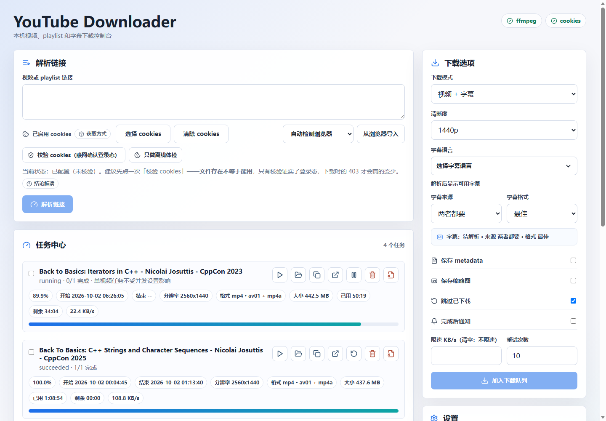
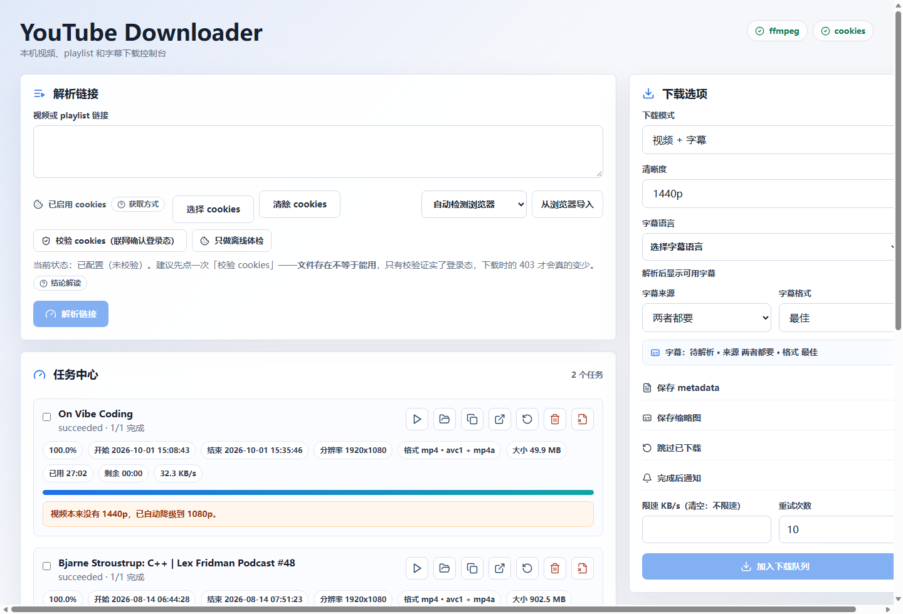
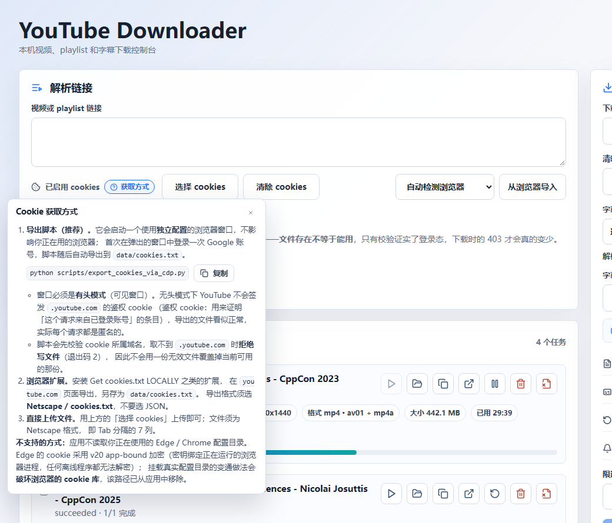
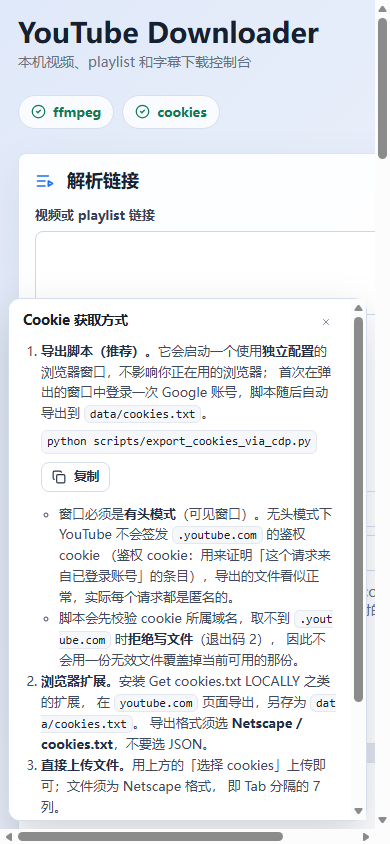

# 用户手册

适用读者：需要在本机解析、下载单视频或 playlist 的用户。最短启动命令见 [README 快速启动](../README.md#快速启动)，开发环境和依赖细节见 [开发文档](development.md)。

## 项目定位

YouTube Downloader 是本机单用户工具。前端提供链接解析、下载选项和任务中心，后端通过 `yt-dlp` 下载媒体并用 SQLite 保存任务状态。系统入口由 [FastAPI 应用](../backend/app/main.py#L40) 和 [React 应用](../frontend/src/App.tsx) 组成。

请只下载你拥有权利或已获得许可的内容。本项目不绕过 DRM、会员、地区、年龄、私有视频等权限限制。

## 启动应用

普通用户按 [README 快速启动](../README.md#快速启动) 运行 `init/` 下对应平台的脚本即可（一键完成「安装依赖 → 构建前端 → 启动后端」的单端口模式）。启动后命令会打印实际监听地址，默认是 `http://127.0.0.1:8000`：

```text
服务地址：http://127.0.0.1:8000
```

端口只有一个来源：仓库根 `.env` 里的 `YTDL_API_PORT`（默认 `8000`），也可以用 `init` 脚本透传 `--port 8010` 临时换、`--auto-port` 让它在被占用时自己往后找，详见 [README 快速启动](../README.md#快速启动) 与 [开发文档](development.md#端口被占用时)。它**不在设置面板里**。如果启动时提示 `WinError 10013`，**那不是权限问题**，而是默认端口已被别的程序占着 —— 启动命令会直接告诉你占用者是谁，处置办法见 [排障手册](troubleshooting.md#启动就失败端口被占用)。

打开后预期看到 YouTube Downloader 首页：左侧包含“解析链接”和“任务中心”，右侧包含“下载选项”和“设置”，顶部状态条会显示 `ffmpeg` 和 `cookies` 状态。首页示例：



`http://127.0.0.1:5173` 是开发者热更新入口；只有按 [开发文档的开发模式](development.md#本地运行)（或 `init` 脚本的 `dev` 参数）启动 Vite dev server 后才应访问该端口。

### 辅助说明的查看方式

界面里所有解释性内容（Cookie 获取方式、校验结论解读、代理常用端口、连通性排查顺序、单视频并发下载的启用方式）**都不平铺在页面上**，而是收在对应功能区里的一个带问号图标的胶囊按钮中（例如「获取方式」「常用端口」「怎么启用」）：



- **默认收起**：说明不占版面高度，主功能区不会被说明挤走。
- **打开方式**：桌面端悬停即看，点击则固定展开；窄屏（≤ 640px）点击后展开为**底部抽屉**。
- **不抢焦点、不阻塞操作**：说明是浮层，没有遮罩层；打开时不会把光标从你正在输入的输入框里拿走，随时点空白处、按 `Esc` 或点右上角 × 关闭。
- **展开状态可记忆**：点开过的说明在下次打开页面时保持展开；`Esc` 或点空白处关闭会一并清除这条记忆。
- **入口紧贴它解释的对象**：获取方式在 cookies 状态旁，结论解读在 cookies 校验按钮下方，常用端口在设置面板的代理输入框旁，排查顺序在代理检测结果下方，怎么启用（单视频并发下载）在那一项输入框旁。

在代理输入框旁展开「常用端口」的桌面端效果：



窄屏下同一内容变成底部抽屉：



## 基本下载流程

1. 在首页输入单视频或 playlist 链接，点击解析。
2. Playlist 会展示条目列表，可选择要下载的子视频；后端会根据选择生成 `JobItem`，见 [创建任务路由](../backend/app/api/routers/jobs.py#L28)。
3. 在下载选项中选择下载模式、清晰度、字幕语言、字幕来源、字幕格式、metadata、缩略图、限速、重试和通知；默认清晰度为 `1440p`，默认字幕来源为“两者都要”。
4. 点击加入下载队列，在任务中心观察进度、速度、预计剩余时间、实际分辨率和实际格式。
5. 对任务执行暂停、重启、仅删除任务，或删除任务并删除已下载文件；前端 API 调用见 [api.ts](../frontend/src/shared/api.ts#L56)。

## 下载选项

下载选项的数据结构由 [DownloadOptions](../backend/app/contracts/schemas.py#L113) 定义，前端对应类型见 [types.ts](../frontend/src/contracts/types.ts#L43)。

| 选项 | 行为 |
| --- | --- |
| 下载模式 | 支持视频+字幕、仅视频、仅字幕。 |
| 清晰度 | 默认 `1440p`。用户只选择清晰度；具体格式由后端自动选择。若源视频没有该清晰度，后端会按降级策略给出明确原因。**取值写法**：只接受 `best` 或 `<高度>p`（如 `1440p`）；大小写与首尾空格会自动归一化（`1440P`、` 720p ` 都可以），但**没有唯一解释的写法会被当场拒绝**（`1080`、`hd`、`1440p60` 会提示你该写成什么），不会静默改成「最高画质」。 |
| 字幕语言 | 可选择人工字幕、自动字幕或两者；当前视频没有任何字幕时，界面显示“无字幕”。**只处理中文和英文**，其它语种在下载时会被忽略（粤语不算中文）。留空时应用按视频的**主语言**自己挑一条：英文视频取英文字幕、中文视频取中文字幕 —— 主语言是 YouTube 标出的原声语言，不是猜的。 |
| 字幕来源 | 默认“两者都要”。若人工字幕或自动字幕缺失，界面会提示已 fallback 到另一种可用字幕来源。下载时的实际顺序是**人工/官方字幕优先，没有才用机器生成的（ASR）**；两者都没有就跳过字幕，**视频照常下载、不报错**。 |
| 字幕格式 | 默认“最佳”；界面会显示实际提交的字幕来源和字幕格式。下载到的字幕会记下**语言与来源**（人工 / 自动生成 / 无字幕），投稿到 B站 时会用到它。 |
| 跳过已下载 | 默认开启，避免覆盖已有文件。 |
| 限速 KB/s（清空：不限速） | 默认空值，不限速；填写后会保存为全局运行时设置，并传给 yt-dlp 的 `ratelimit`。 |
| 重试次数 | 默认 10；修改后会保存为全局运行时设置，用于 yt-dlp 下载重试。 |
| 单视频并发下载数（1–4） | 把**一个视频**切成几段同时下载，默认 2。它由 `aria2c` 提供（一个命令行下载工具），后端默认关闭：要先装好 aria2c、再以 `YTDL_ARIA2C_ENABLED=true` 启用，重启后才生效；而且它只在默认下载方式失败后作为后备被用到，不是每次下载都走。段数越高越可能触发 YouTube 限速或 403，出问题先降回 1。查询与启用方式见该项旁的「怎么启用」说明。 |
| 完成后通知 | 默认**开启**。它决定「这一次要不要提醒」；提醒**用什么方式**在设置面板的「任务完成提醒」里选。 |

清晰度和格式的具体选择规则集中记录在 [技术文档](technical.md#清晰度与格式选择)。

### 任务完成提醒

任务跑到**终态**（下载完成或失败）时可以提醒一次。方式是全局设置，四种取值：

| 取值 | 行为 |
| --- | --- |
| 不提醒 | 什么都不做。此时下载选项里的「完成后通知」会显示成**不可勾**，并写明原因。 |
| 提示音 | 播放一声合成的「叮」（C6 → G6 两个正弦音，没有音频文件跟着仓库走）。标签页在后台也听得见。 |
| 右下角弹窗 | 右下角浮出一条通知，约 6 秒后自动缩回；鼠标停在上面时会暂停缩回，也可以手动关掉。 |
| 提示音 + 弹窗 | 两者都要（默认）。 |

三条设计约定：

- **取消不提醒**：取消是你自己点的，再播报一遍是把刚做过的事念出来。
- **刷新页面后仍然算数**：「这个任务勾没勾通知」由后端从任务选项里读出来（见 [api.md](api.md#jobread-与-jobitemread) 的 `notify_on_complete`），不是靠浏览器记住。
- **标签页在后台时弹窗不会自己消失**：那种情况下倒计时会等你切回来才继续 —— 否则「弹窗」这种方式在后台等于没选。

设置里有一个「预览」按钮，按当前选中的方式演示一次（不用等一个真实任务跑完）。提示音需要浏览器允许该页面播放音频；第一次使用可以点一下「预览」来解锁。

设置面板中的并发默认值为 5，表示**同时下载的视频数量**（一个合集里的多个子视频也会占用这些槽位）；如果网络连接不稳定，建议改为 1。注意并发是视频级的：**单个视频任务不受并发设置影响**。并发、限速和重试次数都会在修改后立即应用，并显示“保存中...”“已保存”或“保存失败”：队列中和暂停中的任务会使用新值，正在下载的视频会取消当前 yt-dlp 实例并以断点续传方式重新入队，以便应用新的限速或重试次数。**「单视频并发下载数」与这个并发是两回事**：并发管的是同时下载几个视频，对单视频无效；单视频并发下载数管的是一个视频**内部**切成几段同时下载，因此它是单视频任务唯一的提速手段。

## 任务中心

任务中心展示任务级和子视频级状态。后端 API 返回的字段见 [JobRead](../backend/app/contracts/schemas.py#L199) 和 [JobItemRead](../backend/app/contracts/schemas.py#L160)，前端展示组件见 [JobQueue](../frontend/src/task-center/JobQueue.tsx#L24)。
Playlist 展开后会用浅色分组背景承载子视频列表，便于区分合集任务行和单个视频任务。

| 信息 | 说明 |
| --- | --- |
| 进度 | 运行中显示聚合进度；分离音视频流不会在音频流开始时回退到 0。同一视频的音频合并会紧跟视频流开始，中间不再故意停顿数秒。 |
| 视频大小 | 下载前预检测到文件大小时即显示计划大小；下载中会随 yt-dlp 进度校准；下载完成后保留最终大小。 |
| 视频时长 | 跟在「大小」之后，格式为 `时:分:秒`（例如 `1:02:05`），**不到一小时也保留时位**，便于和「已用/剩余」区分。建任务时就从解析结果写入；平台没给时长的视频显示 `未知`。合集任务行显示各子视频时长之和，其中有子视频还没有时长时前缀「已知」（与「大小」同一套折法）。 |
| 速度 | 运行中显示瞬时速度；结束后保留平均速度。 |
| 实际分辨率/格式 | 下载前预检测后即写入，完成后再按 yt-dlp payload 或输出文件校准。 |
| 失败原因 | 单视频失败时直接显示具体错误；playlist 可展开查看每个子视频错误。若错误以「当前 cookies 状态：未配置」开头，说明这是 403 的高风险前置条件，先导入 cookies 再重试。 |
| 停滞失败 | 若出现「下载停滞：N 秒内没有新增字节」，表示该连接在阈值时间内已不再产出数据；应用会主动把任务判为失败而不是无限等待。直接重启该任务即可，必要时把并发降为 1。 |
| 自动降级提示 | 根据后端 `resolution_fallback.message` 展示，原因详见 [技术文档](technical.md#分辨率降级原因)。 |
| 播放视频 | 已有输出文件的单视频任务和 playlist 子视频可点击播放按钮；后端会优先选择 VLC、mpv、PotPlayer、MPC 等更可靠的播放器，找不到可确认能解码当前格式的播放器时，错误会显示在对应任务行附近，并提示当前格式和建议播放器。 |
| 打开视频文件夹 | 已有输出文件或任务下载目录的单视频任务和 playlist 子视频可点击文件夹按钮，打开视频所在目录；Windows 下会新开 Explorer 窗口并尽量置前，避免只在任务栏闪烁；若本地文件操作失败，错误会显示在对应任务行附近。 |
| 打开合集文件夹 | Playlist 任务行可点击文件夹按钮，打开该合集下载目录；Windows 下会新开 Explorer 窗口并尽量置前。 |
| 打开字幕 | 「打开视频文件夹」右边那个带字幕图标（CC）的按钮。**字幕下载到的条目才有**，没下到字幕的条目按钮是灰的（悬停会说明「字幕文件尚不可用」）。点它会弹出「打开方式」：正常情况下就是 Windows 自己那个（能选记事本、VS Code、CLion、写字板等）；如果系统的这个界面不正常（只弹一个「若要更改默认应用…」的小框），应用会自动换成自己的对话框，里面列出系统登记过的程序 + 本机能找到的常用编辑器，还能「浏览…」自己挑一个 exe。点按钮后会先显示「正在打开…」，最多等一两秒。打开失败会在对应任务行旁边写明原因。 |
| 复制链接 | 单视频任务、playlist 任务和 playlist 子视频都可点击复制按钮复制源链接。 |
| 打开 YouTube 页面 | 单视频任务、playlist 任务和 playlist 子视频都可点击外链按钮打开对应 YouTube 页面。 |
| 删除操作 | 每个任务和 playlist 子视频都提供“仅删除任务”和“删除任务并删除已下载文件”两个入口；任务中心和 playlist 展开区都支持多选后批量删除；删除文件入口使用文件删除图标并会先弹出确认框。 |

对于旧任务或下载中任务，如果数据库还没有记录最终 `output_path`，后端会按 YouTube 视频 id 在任务下载目录中查找已存在的视频、部分下载文件和 sidecar 文件。找到最终视频时，播放按钮会恢复可用；只有部分下载文件时，打开文件夹和删除文件仍可工作。

**关闭应用不会丢任务**：上次退出时还没下完的条目，下次启动会自动重新排队并接着下（已有的 `.part` 会被续传），日志里有一行「启动恢复：重新排队 N 个条目」。**你按过「暂停」的任务不会自动恢复** —— 暂停优先于一切策略，重启后仍是暂停。想清掉大批陈年积压而不想让它自动继续，用 `YTDL_ORPHAN_RECOVERY=fail` 启动一次，它们会被标成失败并逐条写明原因，见 [排障手册](troubleshooting.md#重启后任务永远停在排队中)。

### 操作失败时，红条在哪儿

失败的回执是一条**贴着屏幕顶边的红条**（不是页面最上面那段内容）：

- **滚在哪儿都看得见**。不滚动时它照旧排在标题下面；一旦你往下滚过，它会贴住屏幕顶边跟着你走。
  所以你在任务中心、设置面板、B站 体检区操作失败时，不用再滚回页面顶端去找那句话。
- **不会自己消失**。红条里常常写着要照着做的下一步（路径、建议、该重试还是该先改设置），
  读不完就缩回等于没提示。它只在这三种情况下消失：点右边的「×」、焦点在条上时按 `Esc`、
  或者**你开始下一个动作**（旧的失败已经不说明当前这件事了）。
- **同一次只显示一条**：新的失败替换旧的，不排队、不叠罗汉。
- **不会把你正在看的地方挤走**：红条出现时页面不会自动滚动；浏览器会把当前这一行钉在原处
  （实测参照卡片位移 0px）。
- **窄屏（手机宽度）也一样**：红条铺满内容宽度、文字自己换行，不会把页面撑出横向滚动条。

哪些失败走这条红条：解析链接、创建任务、cookies 上传/清除/从浏览器导入、任务中心的暂停/重启/删除/
批量操作、复制链接、下载选项里的限速与重试保存、B站 的打不开上传窗口与各类重试、以及首次加载设置失败。

哪些**不**走红条（它们就近显示，离你正在操作的地方更近）：解析面板里的 cookies 锁库提示、
任务行上播放/打开文件夹/打开字幕的失败、上传表单里的错误、设置项的「保存中 / 已保存 / 保存失败」。
判据是「这条错误在说谁的事」—— 说整页的失败用红条，说某个输入框或某一行的就贴在那一处。

## 上传到 B站

下载完成的视频可以再投稿到 B站。这是**另一条独立链路**：独立账号、独立的登录文件（`data/bilibili/cookies.json`，与下载用的 `data/cookies.txt` 互不影响）、独立队列，并且**一次只投一个**（B站 对连续上传有限流，所以两条之间会间隔一会儿）。下载链路不认识它，它也不会触发下载。

### 先做一次体检

设置面板最下面的「B站 上传」区会列出三件事，缺任何一件都会挡住上传，每条都会告诉你**下一步**：

| 检查项 | 不通过时怎么办 |
| --- | --- |
| 投稿工具 | 界面会给出一条 `winget install --id ForgQi.biliup-rs --exact`。如果它显示的是「找到的 biliup.exe 是个 **0 字节的空壳**」，那是 WinGet 没开开发者模式留下的残骸 —— 点旁边的「修复」，不用重装。 |
| 登录状态 | 点「扫码登录」用 B站 App 扫一下，或点「导入 cookies.json」用一份已有的登录文件。 |
| 封面抽帧 | 没有 ffmpeg 只意味着不会自动生成封面（B站 会自己选一帧），**不影响上传**。 |

**右上角的「重新体检」**：点下去按钮会变成「体检中…」并暂时不可点，结束后左边出现「上次体检 11:58:03」。
结论没变时，那个时间戳就是「它确实又跑了一遍」的唯一证据。它不是每次都立刻回来 —— 账号那一项要真的
连一次 B站；**超过 25 秒没回应、或者那一次直接失败，都会退回离线检查**（只查工具与登录文件在不在），
并在下面写明是哪一种：等太久，还是 B站 那边报了什么错。25 秒这个数比后端自己的等待（20 秒）长，
所以它只会在**真的**没回应时才说话 —— 否则你早就不耐烦了，而后端其实还在正常地等。

关于安全，有两条是刻意这么做的：

- **界面不显示任何凭据内容**：登录文件只报「有几项」，连名字都不列；要看登录的是谁，看账号名。凭据一旦显示出来，截图与 bug 报告就会带走它。
- **「登录文件已经被 git 跟踪」会单独红字报出**：那等于把账号密码提交进了仓库。按提示执行 `git rm --cached <该文件>`、确认 `.gitignore` 覆盖它，然后重新登录。

### 单个视频

任务行（或 playlist 展开后的条目行）上有「B站图标 + 上传」按钮。视频还没下载好时它是灰的，鼠标悬停会说明原因。

**这个按钮点下去做什么，取决于这条稿件现在到了哪一步** —— 因为其中有两个状态一旦重复投稿就撤不回来：

| 按钮上写着 | 点一下会 | 悬停提示 |
| --- | --- | --- |
| 上传 | 打开投稿表单 | 上传到 B 站 |
| 上传中 | **什么都不做**（灰着） | 正在上传中；跑完会自动变成「已上传」或「失败」 |
| 待核对 | **只重新核对一次**，不会重投 | B 站还没确认这条稿件；点击重新核对（不会重投） |
| 部分失败 | **只补没成功的那几条**（合集任务） | 有 N 条还没投上去；点击只重试这几条，不会重投已上传的 |
| 上传失败 | 打开投稿表单（元数据可以改） | B站：上传失败 · 点击重新上传 |
| 已上传 | 打开这条稿件在 B站 的页面 | B 站已上传；点击进入 B 站 |

规则只有一条：**已经在平台上的东西绝不会被再投一次。**「待核对」是「投稿命令成功了、但列表里还没查到」，
平台上很可能已经有这条稿件，所以它只核对、不重投；「部分失败」意味着有的上去了有的没上去，所以它只补
没成功的那几条，绝不动已发布的。想看某一条的具体情况，展开后点那一行自己的按钮。

合集任务上「已上传」打开的是**第一个**视频的页面；要看别的，展开后点那一行自己的按钮（它只打开那一条，
不会拿别的顶替）。万一本地没记下这条稿件的 BV 号，按钮会退回去当上传入口用 —— 那种情况下它的提示仍是
「点击重新上传」，说的也是实话。

### 关于「标题过长 / 文件名过长」

B站 有一条**没写在文档里**的限制：视频**文件名**（不含扩展名）也按 80 个字符算，超了会报
`21104 第(1)个视频的标题过长`。下载器会在文件名后面加 ` [YouTube ID]`，所以一条标题只有 71 字的视频
也可能撞上它。

- 应用会自动处理：文件名太长时，上传前在**同一个文件夹**里建一个短的临时名字（硬链接，不复制、不占额外空间），
  传完就删掉；你自己的文件名一个字都不改。
- 所以遇到这类错误**点「重试」就行**。若仍报同样的错（例如文件夹在 exFAT/网络盘上、建不了硬链接），
  把源视频文件改个短一点的名字再重试。
- 这类错误的结论会明确写「文件名太长」，不再说成「登录已失效」—— 旧版本正是那样，害得人反复扫码。

### 上传进度怎么看

点下上传之后，任务卡片里会多出一块「上传进度」，一条四段的轨迹：

```
上传进度                                        已用 01:07
━━━━━━━━━━  ━━━━━━━━━━  ──────────  ──────────
排队        传输        提交        核对
正在传输视频文件
```

- **四段是四步，不是四段时间**：排队（等前面的传完）→ 传输（视频文件正在往上走）→ 提交（文件传完了，
  正在把标题/分区这些信息发给 B站）→ 核对（回读账号稿件列表确认真的进去了）。
- **当前那一段在动**，走的段变绿；右上角是**已用时间**，每秒刷新 —— 它是判断「还在跑」还是「卡住了」
  最直接的凭据。
- **为什么没有百分比**：投稿工具在后台运行时**不输出已传字节数**（它只在上面那三步给信号），B站 的审核
  也不提供进度。所以这里如实按阶段展示。一个卡在 20% 不动的数字比没有数字更让人焦虑。
- **传输那一段可能很久**：实测一个 14 MB 的视频传了 **481 秒**（约 0.03 MB/s）。这取决于你的上行带宽，
  与界面上有没有进度条无关。等不及可以先做别的，任务在后台跑。
- **合集任务**会写清「第 2/3 条 · 视频标题」，下面还有「已有 1/3 条确认在平台上」。
- **审核中**时四段都走完，下面写「已提交，B 站 审核中」，右上角换成 **「上传用时 00:53」**：那是这一次
  上传**实际用掉的时间**，是个定值、不再往上跳。审核由 B站 人工/机器排队，没有百分比可读，通常几分钟到
  几小时；那段时间**不是我们在传**，所以不记进这个数字里（旧版本会一直往上数，看起来像还在上传）。
- 一旦有了结论（已上传 / 失败 / 待核对），进度块就不再显示 —— 那些情况由明细行与按钮说明，不再占地方。

点开后是一张表单，标题、分区、**这条视频是自制还是转载**、原视频链接、**归集方式**、标签、简介、要不要自动生成封面、要不要置顶一条评论都已预填，改完点「开始上传」即可：

- **「自制 / 转载」默认选的是「转载」**，因为这个工作流搬的都是从别的平台下载来的视频。选「转载」时必须填原视频链接（已经预填成这条视频自己的下载来源），留空按钮会变灰并说明原因 —— B站 要求转载稿必须标明来源，留空会被直接退回来。选「自制」则不显示来源输入框。
- **「归集方式」默认选的是「不归集」**，也就是这条视频单独成稿。想让这条视频进某个合集，选「加入已有合集」并挑一个，或者选「新建合集」并给它起个名字（留空会用视频标题顶上）。归集方式的三条选项与合集表单里那份是同一套，见下一节。
- 每个输入框右边是「已填 N / 上限」的计数，上限**来自服务端**，和 B站 真正会拒的值是同一份。
- **超出上限时，计数那一行会跟着变红并写上「超出 N 个字」**（输入框也会标上 aria-invalid）——
  不需要自己拿两个数字相减才知道超没超。超出上限时按钮会变灰并就地说明超了多少，但**不会**替你截断内容。
  静默截断会让你以为发出去的是完整的。
- **这个任务以前投过一次，表单就会把上次填的内容原样带回来**（标题、简介、标签、分区、自制/转载、
  封面开关、置顶评论；合集连模板和合集名一起），表单开头会写一句「已填入上一次投稿时写的内容」。
  失败后点「重新上传」不用再从零填一遍 —— 可以直接改，也可以整个清空重填。
  版权那项也按上次的选择带回：上次标了「自制」，重投不会悄悄变回「转载」。
  **归集方式不跟着带回**（它取决于你现在账号里有哪些合集），每次都会回到默认值。
- 提交后页顶出现「已开始上传《…》，不归集 —— 跑完这里会变成「已上传」。」（选了归集的话会换成对应的说法），任务行的按钮变成「上传中」。

### 字幕会一起传上去（单视频与合集都一样）

投稿**成功之后**，应用会把下载时存下来的那份字幕一起传到这个稿件上。三点值得知道：

- **它是可以关掉的 CC 字幕，不是烧在画面上的硬字幕。** 观众在播放器里自己选择显示或关闭 ——
  想看无字幕原片的人可以关掉它。
- **表单里就能看到这一条会带什么字幕**：预览表（合集）或预填信息里的「字幕」一栏显示
  `en · 人工`、`zh · 自动生成` 这样的结论；显示「无字幕」意味着这个视频当时没下载到可用的中英字幕，
  **投稿照常进行**，只是没有字幕可传。
- **字幕没传上去不会让这次投稿失败**。稿件该是「已上传」就还是「已上传」；字幕那一栏会写明原因
  （文件没了、格式不对、平台报错等）。这种情况下点「重试」**只会重新传一次字幕**，不会再投一遍视频 ——
  重投会在 B站 留下重复稿件。
- **新投的稿件多半还在审核/转码，这时字幕会先挂不上。** B站 要等稿件可访问才给出分P编号，
  字幕正是挂在分P上的。遇到这种情形，字幕那一行会写「平台还没给出分P编号」并出现
  **「重传字幕」**按钮：等审核过了（几分钟到几小时不等）再点一次即可，**同样不会重投视频**。

只有中文和英文字幕会被下载和上传，其它语种一律忽略。

### 整个合集

在一个有 2 条以上视频、且**全部下载完**的 playlist 任务上点同一个按钮，打开的是合集表单：

- 标题与简介填的是**模板**，可以用 `{index}`（序号 01、02…）、`{title}`（该视频标题）、`{count}`（总条数）、`{job}`（任务名）、`{source}`（原视频链接）。下面的预览表会**当场**按模板算出每条视频将提交的标题，改一个字就能看到效果。
- **标题长度量的是渲染后的每一条，不是模板本身。** 模板 `{title}` 只有 7 个字，永远「合规」；而 B站 拒的是替换完之后那一条（平台会把「标题」与「视频文件名」都按 80 个字符算，见[关于「标题过长 / 文件名过长」](#关于标题过长--文件名过长)）。所以标题框下面除了模板自身的字数，还有一行**「渲染后最长 N/80（第 X 条）**」—— 哪一条最长、离上限还差几个字，都在这行里；一旦有超限的，它会变红并写「超出 M 个字」，底部按序号点名超限最多的那条，提交按钮同时变灰。反过来也成立：模板自己写得长但渲染出来短，应用不会拦你（服务端本来也不校验模板）。
- 表单里同样有「自制 / 转载」（默认转载），但**没有**「原视频链接」输入框 —— 合集里每条视频的出处都不一样，应用会在投稿时给每一条各填上它自己的原始链接。这条模板里的 `{source}` 也会逐条展开成各自的值。
- 有一条还没下载好时，预览表里那一行会标注「还没下载好」，底部按序号点名，提交按钮变灰 —— 比让你点完确认再吃一个错误有用。
- **上次投过的模板会原样带回来**（连同合集名、封面开关和置顶评论），表单开头会写一句「已填入上一次投稿时写的内容」。批量重投时最费的就是重新想一遍模板，所以它和标题一样不该丢。
- 提交后应用会**逐个**投稿，中间自动间隔。全部确认发布之后怎么归，你在表单里的**「归集方式」**说了算：

| 归集方式 | 单视频表单里默认 | 合集表单里默认 | 做了什么 |
| --- | --- | --- | --- |
| **新建合集** | | ✓ | 建一个新合集，再把这些视频加进去。合集名预填成任务名（单视频就是视频标题），可以改；简介不用填，应用会写一句。 |
| **加入已有合集** | | | 从下拉里挑一个这个账号下**已经存在**的合集，只往里加视频，**不新建**。下拉里会显示每个合集现有多少个视频。 |
| **不归集** | ✓ | | 投稿照旧，但不建合集、也不进任何合集。 |

（两个默认值刻意不同：改动前合集是每一次都新建，而单视频从来不进任何合集。保持原样才不会在你升级之后，账号里悄悄多出或缺少一批合集。）

四点值得知道：

- **读不到合集列表时，投稿本身不受影响**。默认那两个选项都不需要这份列表，所以列表拉失败只影响「加入已有合集」那一项 —— 它会显示原因（通常是还没登录）并让你改选，而不是把整张表单卡在「正在读取…」上。别把原因当成「这个账号还没有合集」：那会让你去新建一个其实已经存在的。
- **这份列表要等你选了「加入已有合集」才会去读**。另外两个默认选项都用不上它，而读它要真的往 B站 发一次请求。所以打开投稿表单是**立刻**的；万一这次读取超过 25 秒还没回来，界面会把结论写成「读不到 + 可能的原因」，而不是让你对着「正在读取…」干等（迟到的真结果会把它替换掉）。
- **「不归集」不会留下任何痕迹**：单视频任务上一次不归集，任务行里什么都不会多出来。这是有意的 —— 否则每个投过的单视频都会挂一行「未归集」。
- B站 对合集有**人工审核**，所以归集完显示的是「已提交归集」，不等于合集已经公开。

### 「跑完了」怎么看

B站 的稿件列表有几十秒到几分钟的延迟，所以「命令跑完了」不等于「平台上有了」。应用会回读账号的稿件列表核对，因此按钮上的文案分三档，**含义不同**：

| 文案 | 含义 | 该做什么 |
| --- | --- | --- |
| 已上传 | 平台列表里已经确认有这条稿件。 | 不用管。想看看就**点这个按钮本身**（它这时是「进入 B 站」，点开就是稿件页面），或点明细行里的「在 B 站查看」。 |
| 待核对 | 投稿命令成功了，但平台列表里暂时还没看到它 —— **这不等于失败**，平台上很可能已经有这条稿件。 | 等几分钟点「重新核对」（任务行那个按钮点一下也是这个动作，**不会**再投一次稿）。它**只**重新读一次平台列表。也可以直接去创作中心确认。 |
| 上传失败 | 这一步确实没成（工具报错、网络中断等）。 | 看明细里的原因与建议，再点「重试」——会按原来的信息重新投一次。 |

合集那一行是单独记的：稿件都投上去之后，归集这一步失败**不会**把稿件标记成失败。合集行会显示「归集失败」并给一个「重试归集」——重试**只会补加视频，不会重复建合集**。归集成功后显示「已提交归集（B站 需人工审核）」：B站 对合集有人工审核，通过之前可能暂时看不到。

**「等待归集」那一档要等 B站 审核**：稿件刚投上去常常还在审核/转码，平台这时还没给出分P编号，而合集必须
拿这个编号才能加视频。所以合集行会写「视频还在 B站 排队审核，暂时没法加进合集」。等审核通过后再点一次
**「重试归集」**：它会**先去平台核对编号**再归集，一次点击就能加进去（不必重新上传，也不会重复建合集）。
点下去会看到按钮变成「归集中…」，结束后旁边留一个「上次重试 12:34:56」的时间戳 —— 如果视频还没过审，
合集行本身不会有变化，这两样是「这一下真的跑过」的凭据，页顶还会写一句「这次没有发起归集：……」。

还有一条边界值得知道：**投稿是否成功靠「标题前缀」在最近稿件里对账**，所以投稿后在应用里改了标题就再也对不上，这条记录会一直停在「待核对」。这不是卡住了，也不会自动重投。

## 代理与网络

**先分清三件事**，很多「网络问题」其实不是同一个问题：

| 问题 | 界面上的抓手 |
| --- | --- |
| 当前**用的是哪个**代理？ | 设置面板里那行 `当前生效：…（来源：…）` |
| 用了之后**通不通**？ | 设置面板的「检测代理」按钮 |
| 我填的地址**为什么没生效**？ | 看「来源」：`你手动填写的地址` / `Windows 系统代理` / `环境变量（HTTP_PROXY / HTTPS_PROXY）` / `强制直连` |

代理输入框在「设置」面板，语义有三类：

| 填什么 | 含义 |
| --- | --- |
| 留空 | **自动**：优先用 Windows 系统代理，其次用环境变量。留空**不等于**直连。 |
| `direct`（也可写 `none` / `off` / `-`） | 强制直连。适合本机本来就该直连的场景：让请求立刻失败，而不是干等 30 秒超时。 |
| 代理地址 | 直接用它；缺 scheme 会自动补 `http://`，所以 `127.0.0.1:7890` 这样填也行。 |

输入框**离开时自动保存**。如果只想先确认地址对不对，点「先试输入框里的地址」：
这个按钮会拦住点击造成的失焦，因此**只发一次连通性探针、不写设置**；确认能通之后再离开输入框保存。

需要确认端口时，点代理输入框旁的「常用端口」说明，浮层里是一份可直接点击填入的对照列表：

| 软件 | 默认地址 | 说明 |
| --- | --- | --- |
| Clash / Clash Verge / Mihomo | `127.0.0.1:7890` | 混合端口（HTTP 与 SOCKS 共用同一端口） |
| v2rayN | `127.0.0.1:10809` | HTTP 代理端口；SOCKS 端口通常是 10808 |
| Shadowsocks / SS 客户端 | `127.0.0.1:1080` | 本地 SOCKS5 端口，本应用同样支持 |
| Surge / Quantumult 等 | `127.0.0.1:6152` | HTTP 代理端口 |

「本地端口」指代理软件在本机 `127.0.0.1` 上监听的端口，以代理软件设置界面里显示的值为准；上表只是常见默认值。

「检测代理」会真的请求一次 `https://www.youtube.com/robots.txt`（几百字节、必然存在），并把结果原样给出：
HTTP 状态码、耗时、收到多少字节、原始异常，以及下一步建议。**只报「失败」不给证据的检测没有意义**，
所以这里刻意不复用 yt-dlp（它自带重试、cookie、profile 逻辑，失败时分不清是代理坏了还是提取器坏了）。

两个高频误判：

- **浏览器能打开 YouTube ≠ 应用能。** 浏览器可能走系统代理或它自己的插件代理，应用用的是设置里那一份，
  是两条独立路径。反过来也一样。
- **「强制直连失败」不一定是故障。** 如果本机其实需要代理，直连失败是预期结果——它反而证明了代理参数确实在起作用。

要按顺序定位时，点检测结果下方的「排查顺序」说明，浮层里是五步定位顺序：

1. 点「检测代理」确认出口连通性；返回非 200 状态码或超时，问题在代理链路本身。
2. 确认代理软件处于运行状态；软件退出后系统代理可能被清空或仍指向无人监听的端口。
3. 核对端口（见上表）。
4. 区分两条独立路径：浏览器可能用系统代理或插件代理，本应用只认设置面板里填的地址。
5. 本机确需直连时填 `direct`，让请求立刻失败，而不是等待 30 秒超时。

## Cookies

当 YouTube 要求登录、年龄验证或人机校验时，需要导入 cookies。**先看一件事：文件存在不等于能用。**

### 三种获取方式

界面入口：解析面板里 cookies 状态旁的「获取方式」说明。三种途径按推荐顺序排列：

1. **导出脚本（推荐）**：`python scripts/export_cookies_via_cdp.py`。它会开一个**独立配置**的浏览器窗口，
   不影响你正在使用的浏览器；第一次在弹出的窗口里登录一次 Google 账号，之后自动导出到 `data/cookies.txt`。
   窗口必须**有头**（看得见的窗口）——无头模式下 YouTube 不会签发 `.youtube.com` 的鉴权 cookie，
   导出的文件看着正常但每个请求都是匿名的。脚本会先校验域名，拿不到 `.youtube.com` 就**拒绝写文件**（退出码 2），
   所以它不会用一份废文件覆盖掉你原来能用的那份。
2. **浏览器扩展**：安装 *Get cookies.txt LOCALLY* 之类的扩展，在 `youtube.com` 页面导出 Netscape 格式，
   另存为 `data/cookies.txt`。注意选 **Netscape / cookies.txt**，不要 JSON。
3. **直接上传文件**：用解析面板里的「选择 cookies」上传，格式必须是 Tab 分隔的 7 列（Netscape 格式）。

### 校验 cookies

解析面板里 cookies 状态下方有三个按钮，分别对应三种强度：

| 按钮 | 做什么 |
| --- | --- |
| 校验 cookies（联网确认登录态） | 离线体检 + 真的拿这份 cookies 访问一次 `https://www.youtube.com/`，读页面里的 `"LOGGED_IN"` |
| 只做离线体检 | 只看格式、域名、鉴权项、过期时间，不联网 |
| 重新校验 | 换过文件之后再跑一次 |

结论对照（同样的内容也在界面上的「结论解读」说明里）：

| 结论 | 含义 | 怎么办 |
| --- | --- | --- |
| 未配置 | 没有 `data/cookies.txt` | 用上面三种方式之一导入 |
| 域名不对，等于没配 | cookie 全落在 `.google.com` 上 | 重新导出。`.google.com` 的 cookie **永远不会**发给 `www.youtube.com` |
| 只有匿名 cookie | 只有 `VISITOR_INFO1_LIVE` / `YSC` / `PREF` 之类 | 在导出窗口里真正登录后再导一次 |
| 登录态无效 | 域名与鉴权项都对，但 YouTube 仍认为你是匿名 | 多为登录态过期，或导出后换了出口 IP；重新导出 |
| 登录态有效 | 页面里出现 `"LOGGED_IN":true` | 正常，下载时 403 会明显变少 |

为什么必须校验：实测过一份 9 条 cookie 的文件，`SID`、`HSID` 都在，yt-dlp 也不报错，
但每个请求都是匿名的——因为那 9 条全部落在 `.google.com`。只看「文件存在」永远发现不了这件事。

### 其它导入入口与边界

- 从浏览器导入可选择「自动检测浏览器」或指定 Edge、Chrome、Firefox、Brave、Chromium 等，见 [browser_cookies.py](../backend/app/host/browser_cookies.py#L19)。
- Edge 正在运行导致数据库锁定时会返回结构化错误，见 [BrowserCookieImportError](../backend/app/host/browser_cookies.py#L23)。
  界面上的「关闭 Edge 并导入」会 `taskkill /IM msedge.exe /F /T`，**会关掉你所有 Edge 窗口（含未保存的标签页）**，
  需要你显式点击；能自己先关掉浏览器的话，优先手动关。
- **不要**让应用去读取你正在使用的 Edge/Chrome 配置目录：Edge 的 cookie 是 v20 app-bound 加密，
  密钥绑定正在运行的浏览器进程，离线程序解不开；挂载真实配置目录的变通做法会**破坏浏览器的 cookie 库**
  （实测过 53 条变 0 条），这条路径已从应用中彻底移除。

Cookies 会保存到本地 `data/cookies.txt`，该目录不进入 Git。

### 换网络会让登录态失效

YouTube 把登录态与出口 IP 绑定。导出 cookies 时走代理 A、下载时走代理 B，就会出现
「校验通过但下载 403」。保持导出与下载用同一条出口。

## 自检与日志

设置面板里有一个「运行环境」区块，回答「这台机器到底能不能干活」：

| 显示 | 含义 |
| --- | --- |
| JS 运行时：可用 | 解析 YouTube 的 `n` 参数需要它，**登录状态下是必须项** |
| JS 运行时：不可用 | 会附上原始报错（例如 `ERR_ACCESS_DENIED`）。最典型的症状是下载报 `The page needs to be reloaded.`，而这句话完全指不到病因 |
| 启动时已自动摘除… | 宿主环境往 `NODE_OPTIONS` 里塞了 `--require` 之类会打坏 JS 运行时的变量；应用启动时已摘掉并记录在此 |
| 日志文件：`…\data\logs\app.log` | 出问题时先看这个文件的最后几十行，可以一键复制路径 |

「重新自检」会清掉 JS 运行时的探测缓存重新跑一遍——装完 Node/Deno 之后点它即可，不必重启应用。

日志是 UTF-8、`时间 级别 模块 | 消息` 格式，2 MiB 轮转、保留 3 份备份，**应用启动时就开始写**。
失败时日志里会同时出现一行结构化事实和一行可执行诊断：

```text
2026-10-01 12:01:33 WARNING job_manager | download item failed: job_id=... category=js_challenge_failed error_class=DownloadError error=ERROR: [youtube] aqz-KE-bpKQ: The page needs to be reloaded.
2026-10-01 12:01:33 WARNING job_manager | download item failed advice: job_id=... item_id=...
      诊断: js_runtime_challenge_failed —— YouTube 的 JS challenge（n 参数）解不出来，登录态下的可用格式被判定为空
      原因: ... 当前 JS 运行时自检失败：... ERR_ACCESS_DENIED
      建议1: 按诊断里的提示修复 JS 运行时（Deno 或 Node），修复后在设置里显式填写路径并重新自检
      建议2: ...
```

想要更细的过程用 `YTDL_LOG_LEVEL=DEBUG` 启动。完整的「按症状查」清单见 [排障手册](troubleshooting.md)。

### 界面卡住不动时

界面上的每一次「读取」都有 **60 秒的截止时间**。如果后端把连接接下来却不回话（后端卡死、DNS 挂起、代理黑洞、线程池打满），
你会看到一句**说清原因和下一步**的提示，而不是一句永远不消失的「正在读取…」。

这个值取 60 秒是因为它必须大于服务端已有的所有等待上限（B站 请求 20 秒、打开方式窗口 6 秒、cookies 库等待约 10 秒），
所以正常路径不会被误判为超时。**解析链接**是唯一的例外：它要真的连 YouTube（取元数据、可能还要导入 cookies 并重试、解 JS challenge），
实测能到半分钟以上，所以单独放宽到 **180 秒**——但同样有上限，「永不返回」照样会被封顶。

## 下载目录与产物

默认下载根目录是 `downloads/`，数据库和 cookies 默认在 `data/`，配置默认值见 [AppSettings](../backend/app/contracts/config.py#L19)。Playlist 会在下载根目录下创建同名子文件夹；目录选择和保存逻辑见 [select_download_dir](../backend/app/api/routers/settings.py#L84)。

产物命名模板固定为 `<标题(最多200字节)> [<YouTube id>].<扩展名>`，见 [build_download_options](../backend/app/download/ytdlp_service.py#L496)。因此即使数据库里的 `output_path` 丢失，后端仍能按文件名中的 id 找回同名视频与 sidecar。

## 常见问题入口

**完整清单见 [排障手册](troubleshooting.md)**（按「你看到的那句话」查，直接给到该点哪里）。下面是最常见的几条：

- 解析/下载报 `The page needs to be reloaded.`：几乎总是 JS 运行时的问题，不是网络也不是 cookies。先点「重新自检」，见 [排障手册](troubleshooting.md#js-运行时与-n-challenge)。
- 分析失败或提示 bot 校验：先重新导入 cookies，详见 [技术文档](technical.md#cookies-与登录态)。
- 连不上、超时、`Tunnel connection failed`：先点「检测代理」，见 [代理与网络](#代理与网络)。
- 媒体流 403 或连接重置：查看 [稳定下载策略](technical.md#稳定下载策略)。若 403 变多，把并发降为 1，并确认没有开启 aria2c 多连接，而不是恢复单个视频内部的文件间隔睡眠。
- 任务卡在「下载中」但进度不动：正常情况下停滞看门狗会在 90 秒内把它变成可见失败；如果长时间仍无变化，检查是否用 `YTDL_STALL_TIMEOUT_SECONDS=0` 关闭了看门狗，或进程是否被强制结束。
- 高分辨率下载失败：查看 [清晰度与格式选择](technical.md#清晰度与格式选择) 和 [分辨率降级原因](technical.md#分辨率降级原因)。
- 提示「已自动降级到 XXX」但任务随即失败、没有开始下载：见 [排障手册](troubleshooting.md#提示已降级却没有开始下载)。
- 想直接看证据：`data/logs/app.log`，见 [自检与日志](#自检与日志)。
- API 字段含义不清楚：查看 [API 文档](api.md)。
- 本地依赖或环境问题：查看 [开发文档](development.md)。
